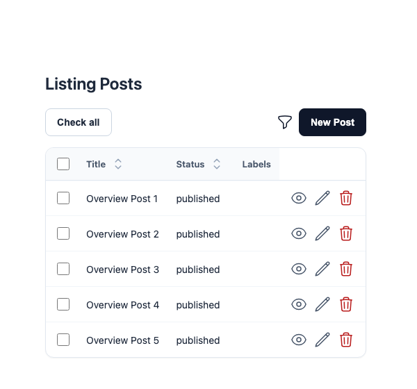
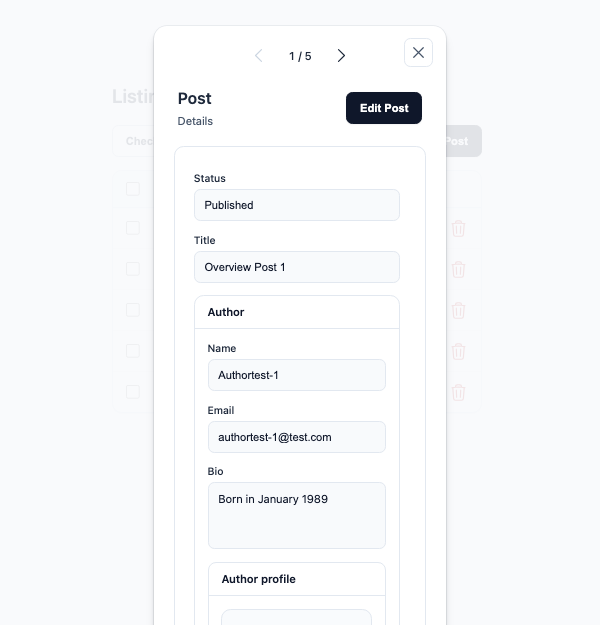
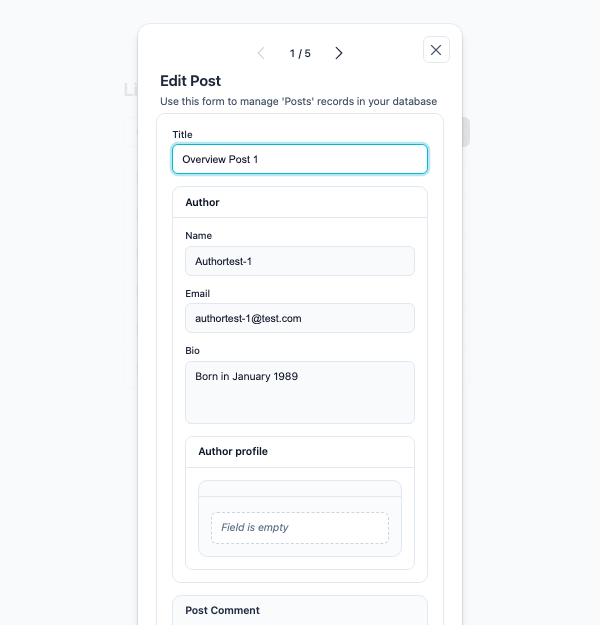
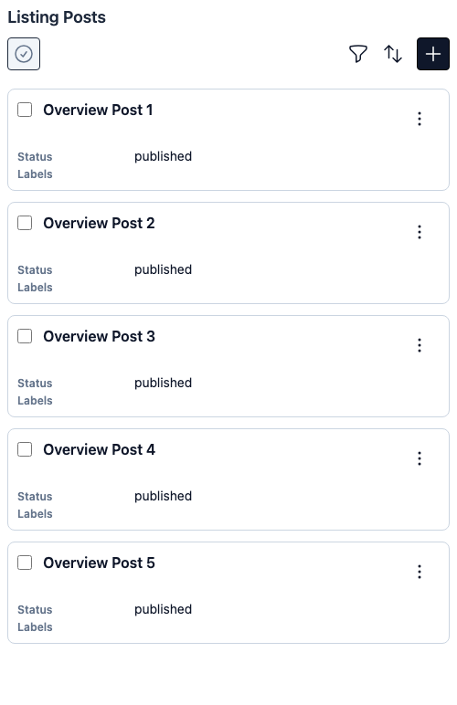
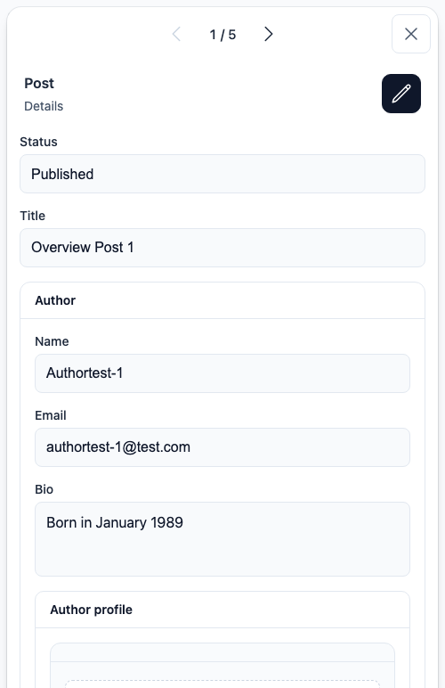
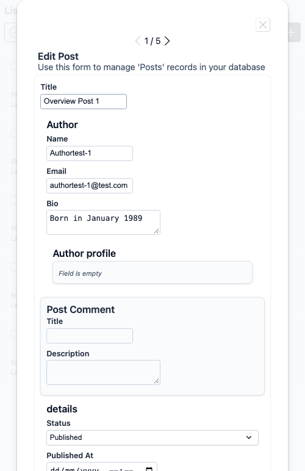

# Ash Framework Integration

Aurora UIX is a powerful low-code framework for building dynamic CRUD UIs in Phoenix LiveView applications. 
While Aurora UIX works perfectly with traditional Phoenix Contexts and Ecto schemas, it also provides **integration** with the [Ash Framework](https://ash-hq.org/).

This guide explains how to leverage Aurora UIX's Ash integration as an alternative backend to the standard Context-based approach.

## Overview

Aurora UIX is designed with a flexible backend architecture that supports multiple data access patterns. 
Aurora UIX seamlessly adapts to use Ash as the backend, transforming your existing Ash resources into complete UI implementations **without requiring any changes to your Ash resources**.

### Why Aurora UIX with Ash?

If your application already uses Ash Framework, Aurora UIX provides:

- **Zero Duplication** - Reuse your existing Ash resource definitions and actions, mildly aligned to Ash concept 'Model your domain, derive the rest'
- **Automatic Action Discovery** - Aurora UIX detects and uses your defined Ash actions
- **Declarative Configuration** - No need to write Context functions or custom queries
- **Type Safety** - Leverages Ash's type system for automatic field inference
- **Constraint Awareness** - Respects Ash constraints like `:one_of` for enum fields
- **Flexible Backend Use** - Use Ash and Context-based resources in the same Aurora UIX application

## Prerequisites

Before enabling Aurora UIX's Ash integration, ensure you have:

1. **Aurora UIX** installed and working (see [Getting Started](../introduction/getting_started.md))
2. **Ash Framework** installed and configured in your Phoenix project
3. **Ash Resources** with defined actions and attributes
4. **An Ash Domain** listing your resources, registered in `config :my_app, ash_domains: [...]`

### Required Dependencies

Besides Aurora UIX, you'll need to add Ash dependencies for using it as a backend for UI rendering. In your `mix.exs`:

```elixir
def deps do
  [
    {:aurora_uix, "~> 0.2.1"},  # Main framework
    {:ash, "~> 3.0"},           # If use Ash as backend
    {:ash_postgres, "~> 2.0"}   # Needed if using postgres as your data layer. Add any other data layer required by your backend
  ]
end
```

## Basic Configuration

### Step 1: Define Your Ash Resources (or Use Existing)

If you already have Ash resources, skip to Step 3. The rest of this walkthrough uses a small blog:
three stored resources and two embedded ones. `MyApp.Repo` must be an `AshPostgres.Repo`; the
[tutorial](../tutorial/build_your_first_app.md) shows how to set Ash up in a new application.

```elixir
defmodule MyApp.Blog.Post do
  use Ash.Resource,
    domain: MyApp.Blog,
    data_layer: AshPostgres.DataLayer

  postgres do
    table "posts"
    repo MyApp.Repo
  end

  attributes do
    uuid_primary_key :id

    attribute :title, :string, public?: true
    attribute :content, :string, public?: true
    attribute :published_at, :utc_datetime, public?: true

    attribute :status, :atom do
      constraints one_of: [:draft, :published, :archived]
      default :draft
      public? true
    end

    attribute :comment, MyApp.Blog.Comment do
      default %{}
      public? true
    end

    attribute :tags, {:array, MyApp.Blog.Tag}, public?: true

    create_timestamp :inserted_at
    update_timestamp :updated_at
  end

  relationships do
    belongs_to :author, MyApp.Blog.Author, public?: true
    belongs_to :category, MyApp.Blog.Category, public?: true
  end

  actions do
    default_accept [
      :title,
      :content,
      :status,
      :published_at,
      :comment,
      :tags,
      :author_id,
      :category_id
    ]

    defaults [:create, :read, :update, :destroy]
  end
end
```

```elixir
defmodule MyApp.Blog.Author do
  use Ash.Resource,
    domain: MyApp.Blog,
    data_layer: AshPostgres.DataLayer

  postgres do
    table "authors"
    repo MyApp.Repo
  end

  attributes do
    uuid_primary_key :id
    attribute :name, :string, public?: true
    attribute :email, :string, public?: true
    attribute :bio, :string, public?: true
  end

  actions do
    default_accept [:name, :email, :bio]
    defaults [:create, :read, :update, :destroy]
  end
end
```

```elixir
defmodule MyApp.Blog.Category do
  use Ash.Resource,
    domain: MyApp.Blog,
    data_layer: AshPostgres.DataLayer

  postgres do
    table "categories"
    repo MyApp.Repo
  end

  attributes do
    uuid_primary_key :id
    attribute :name, :string, public?: true
  end

  actions do
    default_accept [:name]
    defaults [:create, :read, :update, :destroy]
  end
end
```

```elixir
defmodule MyApp.Blog.Comment do
  use Ash.Resource, data_layer: :embedded

  attributes do
    attribute :title, :string, public?: true
    attribute :description, :string, public?: true
  end
end
```

```elixir
defmodule MyApp.Blog.Tag do
  use Ash.Resource, data_layer: :embedded

  attributes do
    attribute :name, :string, public?: true
  end
end
```

### Step 2: Define Your Ash Domain

```elixir
defmodule MyApp.Blog do
  use Ash.Domain

  resources do
    resource MyApp.Blog.Post
    resource MyApp.Blog.Author
    resource MyApp.Blog.Category
  end
end
```

Register the domain and create the tables:

```elixir
# config/config.exs
config :my_app, ash_domains: [MyApp.Blog]
```

```shell
mix ash.codegen create_blog
mix ash.migrate
```

### Step 3: Configure Aurora UIX Resource Metadata

Create a module to configure your UI:

```elixir
defmodule MyAppWeb.BlogViews do
  use Aurora.Uix

  alias MyApp.Blog.Author
  alias MyApp.Blog.Category
  alias MyApp.Blog.Comment
  alias MyApp.Blog.Post
  alias MyApp.Blog.Tag

  auix_resource_metadata :author do
    ash_resource Author
    field :bio, html_type: :textarea
  end

  auix_resource_metadata(:category, ash_resource: Category)

  auix_resource_metadata :post__comment do
    ash_resource Comment
    field :description, html_type: :textarea
  end

  auix_resource_metadata :post do
    ash_resource Post
    order_by :title
    field :tags, resource: :tag
  end

  auix_resource_metadata(:tag, ash_resource: Tag)

  auix_create_ui do
    show_layout :author do
      stacked([:name, :email, :bio])
    end

    edit_layout :author do
      inline([:name, :email, :bio])
    end

    index_columns(:post, [:title, :author, :status])

    show_layout :post do
      stacked([:status, :title, :author, :comment])
    end

    edit_layout :post do
      stacked do
        inline([:title])
        inline([:author])
        inline([:comment])

        group "details" do
          stacked([:status, :published_at])
        end

        inline([:tags])
      end
    end
  end
end
```

### Step 4: Add to Router

```elixir
defmodule MyAppWeb.Router do
  use MyAppWeb, :router

  import Aurora.Uix.RouteHelper

  # ... your pipelines

  scope "/blog", MyAppWeb do
    pipe_through :browser

    auix_live_resources("/posts", BlogViews.Post)
    auix_live_resources("/authors", BlogViews.Author)
    auix_live_resources("/categories", BlogViews.Category)
  end
end
```

The stylesheet and JavaScript hooks are set up as in
[Getting Started](../introduction/getting_started.md).

That's it! Aurora UIX will generate complete CRUD interfaces using your existing Ash actions, without requiring any changes to your Ash resources or domain definitions.

The screenshots below come from the library's own blog demo, which also has many-to-many topics
and labels.

#### Desktop generation

<div align="center">
    
</div>

---

<div align="center">
    
</div>

---

<div align="center">
    
</div>

#### Mobile generation

<div align="center">
    
</div>

---

<div align="center">
    
</div>

---

<div align="center">
    
</div>
## Configuration Options

### Resource Metadata Options

When configuring an Ash resource, you can use these options:

#### Required Options

- `:ash_resource` (module()) - Your Ash resource module

#### Optional Options

- `:order_by` (atom() | list() | keyword()) - Default ordering for index views
- `:type` (atom()) - The type of backend is determined based on the `ash_resource` module.
    Setting this value manually will bypass the detection mechanism, and it is useful to provide a custom backend

#### Alternative Syntax

You can also use `:schema` as an alias for `:ash_resource`. A `:context` is not needed:

```elixir
# These are equivalent
auix_resource_metadata :user, ash_resource: User
auix_resource_metadata :user, schema: User
```

### Examples

#### Basic

```elixir
auix_resource_metadata :author do
  ash_resource Author
  field :name, required: true
  field :bio, html_type: :textarea
end
```

#### With Ordering

```elixir
auix_resource_metadata :post do
  ash_resource Post
  order_by [desc: :published_at]
  field :title, required: true, length: 100
  field :content, html_type: :textarea
  field :published_at, readonly: true
end
```

#### Multiple Resources

```elixir
defmodule MyAppWeb.BlogViews do
  use Aurora.Uix

  alias MyApp.Blog
  alias MyApp.Blog.{Author, Post, Category}

  auix_resource_metadata :author, ash_resource: Author
  auix_resource_metadata :post, ash_resource: Post 
  auix_resource_metadata :category, ash_resource: Category

  auix_create_ui()
end
```

## How Aurora UIX Discovers Ash Actions

One of Aurora UIX's strengths is its ability to work with your existing code. When configured to use an Ash resource, 
Aurora UIX discovers and maps Ash actions to UI operations at compile time.

### Action Discovery Process

For each operation, Aurora UIX picks one action of the matching type:

1. **The configured action** - The one you name in `backend_opts` (see [Custom Actions](#custom-actions)).
   Naming an action the resource does not define for that type fails compilation
2. **The primary action** - Without a configured name
3. **The first action** of the type - When none is primary

An action called `:read`, `:create`, `:update` or `:destroy` has no preference over the primary one.

### Aurora UIX Operation Mapping

| Aurora UIX Operation | Ash Alias | Ash Action Type | Used For |
|---------------------|-----------|-----------------|----------|
| `:list_function_paginated` | `:ash_read_action_paginated` | `:read` (paginated) | Index view, paginated |
| `:list_function` | `:ash_read_action` | `:read` (not paginated) | Index view without pagination, association lists and select options |
| `:get_function` | `:ash_get_action` | `:read` | Show and edit views |
| `:new_function` | `:ash_new_function` | N/A (function) | New form initialization |
| `:create_function` | `:ash_create_action` | `:create` | Create form |
| `:update_function` | `:ash_update_action` | `:update` | Edit form |
| `:delete_function` | `:ash_destroy_action` | `:destroy` | Delete operation |
| `:change_function` | `:ash_change_action` | `:update` | Building the form |

When only one of update and change is configured, it serves both. The two list options exclude
each other: name one of them or none. The named one serves the index, the association lists and
the selects. With neither, they all use the action picked for the index.

### Pagination Support

The index pages its rows through a read action with offset pagination:

```elixir
actions do
  read :read do
    primary? true

    pagination do
      offset? true
      countable true
      required? false
      default_limit 20
    end
  end
end
```

The actions generated by `defaults [:read]` are already paginated.

Without a configured name, the index uses the primary read action if it is paginated, and else the
first paginated read action. Pagination is preferred, not required: when no read action is
paginated, the index falls back to the primary read action, or else the first one, and lists every
row on one page with no pages bar. Compilation fails when the resource has no read action.

### Custom Actions

> **Note:** This section is about **Ash resource actions** (`:read`, `:create`, `:update`,
> `:destroy`). It is unrelated to Aurora UIX's UI action buttons — for adding or replacing
> buttons and links in generated views, see the [Custom Actions](../customization/custom_actions.md)
> guide instead.

Name the actions to use when discovery would pick others:

```elixir
auix_resource_metadata :post do
  ash_resource Post

  backend_opts ash_read_action_paginated: :published_posts,  # Index and association lists
               ash_create_action: :publish,                  # Create form
               ash_update_action: :edit_published            # Edit form

  # field configuration...
end
```

A named read action is always the one used; Aurora UIX never swaps it for another. Name a read
action with the option that matches its definition, and only one of the two:

- `ash_read_action` - an action **without** pagination. The index lists every row on one page.
- `ash_read_action_paginated` - an action **with** pagination. The index pages its rows.

Compilation fails when the two are both given, when `ash_read_action` names a paginated action
(including one generated by `defaults [:read]`), or when `ash_read_action_paginated` names one
without pagination.

Available action configuration options, all given inside `backend_opts`:

- `:ash_read_action` (or `:list_function`) - Read action without pagination, for the index, association lists and select options
- `:ash_read_action_paginated` (or `:list_function_paginated`) - Paginated read action, for the index, association lists and select options
- `:ash_get_action` (or `:get_function`) - Read action for a single record
- `:ash_new_function` (or `:new_function`) - 2-arity function for new form initialization
- `:ash_create_action` (or `:create_function`) - Create action
- `:ash_update_action` (or `:update_function`) - Update action
- `:ash_destroy_action` (or `:delete_function`) - Destroy action
- `:ash_change_action` (or `:change_function`) - Update action the form is built with

> **Note:** Each option has two aliases (e.g., `:ash_read_action` and `:list_function`). The `:ash_*` prefix is recommended for clarity when working with Ash resources.

#### Custom New Function

Unlike other options that reference Ash actions, `:ash_new_function` accepts a function that sets
the initial values of a new record. It receives a map of attributes and the call options, and
returns the attributes as a map or keyword list, not a struct:

```elixir
defmodule MyApp.BlogDefaults do
  def new_post(attrs, _opts) do
    Map.merge(%{status: :draft, title: "Untitled"}, attrs)
  end
end
```

```elixir
auix_resource_metadata :post do
  ash_resource Post
  backend_opts ash_new_function: &MyApp.BlogDefaults.new_post/2
end
```

## How Aurora UIX Renders Ash Relationships

Aurora UIX intelligently handles Ash relationships defined in your resources, automatically rendering them with appropriate UI components based on their type. 
This works with your existing relationship definitions—no changes needed.

### Belongs To Relationships

When the module declares a resource for the related record, the foreign key of a `belongs_to`
relationship renders as a select dropdown:

```elixir
# In your Ash resource
relationships do
  belongs_to :author, MyApp.Blog.Author
  belongs_to :category, MyApp.Blog.Category
end
```

```elixir
# In your Aurora UIX configuration
auix_resource_metadata :post do
  ash_resource Post
  field :author_id, option_label: :name
  field :category_id, option_label: :name
end
```

See [Many-to-One](resource_metadata.md#many-to-one-belongs_to) for the labels and the query of the
options.

### Has Many Relationships

`has_many` relationships are rendered as nested lists with add/edit/delete actions:

```elixir
# In your Ash resource
relationships do
  has_many :posts, MyApp.Blog.Post
end
```

To order or filter the rows, set `query_opts` on the field in the resource metadata, or
`order_by:` and `where:` on the field in the layout, which take precedence over the same option in
`query_opts` (see [One-to-Many](resource_metadata.md#one-to-many-has_many)):

```elixir
edit_layout :author do
  stacked do
    field :name
    field :posts, order_by: [desc: :published_at]
  end
end
```

## Calculations and Aggregates

Aurora UIX automatically parses Ash `calculations` and `aggregates` into fields — no manual configuration required. Both are rendered **read-only / disabled in forms** because they are computed values, not writable attributes.

### Aggregate type mapping

The type of an aggregate is the one Ash resolves for it:

| Aggregate kind | Resolved type |
|---|---|
| `count` | integer |
| `exists` | boolean |
| `sum`, `max`, `min`, `first`, `avg`, `custom` | the type Ash derives from the aggregated field, or the declared one |
| `list` | a list of the field's type, shown read-only |

An aggregate whose type Ash cannot resolve is treated as a string, and an error is logged.

### Calculations

Calculations resolve from the calculation's declared return type. Simple scalar types (`:string`, `:integer`, `:decimal`, `:boolean`, `:utc_datetime`, etc.) map automatically.

### When the type can't be inferred

When the parser cannot map an element it logs an error and the field may render with an unusable type. Declare the field explicitly in `auix_resource_metadata` to fix it:

```elixir
auix_resource_metadata :order do
  ash_resource MyApp.Sales.Order
  # An aggregate/calculation the parser can't type:
  field :latest_status, type: :string, html_type: :text
  field :total_amount, type: :decimal, html_type: :number, readonly: true
end
```

Any `field/2` option overrides the parsed value, so `type:` and `html_type:` give full control for these computed fields. See [Resource Metadata](resource_metadata.md) for the full option list.

### Loading a computed field the parser does not detect

A calculation or aggregate the parser detects is loaded with the entity wherever a layout renders it. Setting `data:` on a field replaces the parsed `data`, including that mark, and a field the parser cannot recognise never gets it. Declare `generated?: true` on such a field so it is loaded too:

```elixir
auix_resource_metadata :order do
  ash_resource MyApp.Sales.Order
  field :total_amount, generated?: true, type: :decimal, html_type: :number
end
```

Without it the field stays `%Ash.NotLoaded{}` on the index and show pages.

## Embedded Resources

Ash supports embedded resources (similar to Ecto embeds). Aurora UIX renders these inline:

```elixir
# Define embedded resource
defmodule MyApp.Blog.Comment do
  use Ash.Resource, data_layer: :embedded

  attributes do
    attribute :title, :string, public?: true
    attribute :description, :string, public?: true
  end
end
```

```elixir
# In the attributes of the main resource
attributes do
  # Single embed
  attribute :comment, MyApp.Blog.Comment, public?: true

  # Array of embeds
  attribute :comments, {:array, MyApp.Blog.Comment}, public?: true
end
```

Aurora UIX will render:
- `embeds_one` - Single nested form
- `embeds_many` - List of nested forms with add/remove actions

A resource declared on an embedded resource generates no modules and no routes. Name it on the
parent field with `resource:` to render the embedded record with its field options; without
`resource:` the field uses the resource named `<parent>__<field>`. See
[Embedded Resources](resource_metadata.md#embedded-resources).

## Advanced Examples

### Custom Layouts with Ash Resources

```elixir
defmodule MyAppWeb.BlogViews do
  use Aurora.Uix

  alias MyApp.Blog
  alias MyApp.Blog.Post

  auix_resource_metadata :post,
    ash_resource: Post,
    order_by: [desc: :published_at]

  auix_create_ui do
    # Custom index columns
    index_columns(:post, [:title, :author, :status, :published_at])

    # Custom show layout
    show_layout :post do
      stacked do
        inline([:title])
        inline([:author, :category])
        inline([:status, :published_at])
        inline([:content])
        
        group "Metadata" do
          inline([:inserted_at, :updated_at])
        end
      end
    end

    # Custom edit layout
    edit_layout :post do
      stacked do
        inline([:title])
        inline([:author_id])
        inline([:category_id])
        inline([:content])
        
        group "Publishing" do
          inline([:status])
          inline([:published_at])
        end
        
        inline([:tags])
      end
    end
  end
end
```

### Conditional Field Display

Use field options to control visibility:

```elixir
auix_resource_metadata :user do
  ash_resource User
  field :id, hidden: true
  field :email, required: true
  field :password_hash, omitted: true  # Completely excluded
  field :role, html_type: :select
  field :created_at, readonly: true
  field :updated_at, readonly: true, hidden: true
end
```

### Filtering and Sorting

Configure default filtering and sorting:

```elixir
auix_resource_metadata :post do
  ash_resource Post
  order_by [desc: :published_at]
  
  field :title, filterable?: true
  field :status, filterable?: true, html_type: :select
  field :author_id, filterable?: true, html_type: :select, option_label: :name
end
```

## Ash vs Aurora UIX Filtering and Sorting

Filtering and sorting can live in the Ash read action or in Aurora UIX. They combine, with two
limits to keep in mind.

### Filtering in the Read Action

A `filter` in the action always applies, to every interface that uses it, and the filters of the UI
narrow its result further:

```elixir
actions do
  read :published_posts do
    pagination offset?: true, countable: true, required?: false
    filter expr(status == :published)
  end
end
```

```elixir
auix_resource_metadata :post do
  ash_resource Post
  backend_opts ash_read_action_paginated: :published_posts

  field :author_id, filterable?: true
  field :category_id, filterable?: true
end
```

Aurora UIX passes **no arguments** to read actions, so a filter or preparation that depends on an
action argument receives `nil`.

### Sorting

Aurora UIX adds its sort (`order_by`, or the column the user clicked) after the action's
preparations. A sort set by the action, such as `prepare build(sort: [published_at: :desc])`,
therefore stays the primary one, and clicking a column header only orders records that tie on it.
Leave the sort out of the read action when users should sort the index, and set the default order
with `order_by`:

```elixir
auix_resource_metadata :post do
  ash_resource Post
  order_by [desc: :published_at]
end
```

## Choosing Between Ash and Context Integration

Aurora UIX supports both integration approaches equally well. The choice depends on your application architecture, not Aurora UIX limitations.

### Use Aurora UIX with Ash Integration When:

✅ Your application **already uses** Ash Framework
✅ You want to reuse existing Ash resource definitions and actions
✅ Your team prefers declarative, action-based resource definitions
✅ You need Ash's built-in features (authorization, multi-tenancy, etc.)
✅ You want to leverage Ash's ecosystem (GraphQL, JSON:API, etc.)

### Use Aurora UIX with Context Integration When:

✅ You're starting a **new project** with Aurora UIX
✅ Your team is more familiar with traditional Phoenix/Ecto patterns
✅ You have an existing Phoenix app with Context modules
✅ You prefer explicit function definitions and direct query control
✅ Your domain logic is straightforward

**Note**: When using Contexts, consider pairing Aurora UIX with [Aurora Ctx](https://github.com/wadvanced/aurora_ctx)—a declarative DSL for Context functions that provides a declarative approach.

**Important**: Both approaches provide the same Aurora UIX features (layouts, field customization, relationships, etc.). The backend choice doesn't limit Aurora UIX functionality.

### Backend Comparison

| Aspect | Aurora UIX with Ash | Aurora UIX with Contexts |
|--------|---------------------|--------------------------|
| **Aurora UIX Features** | ✅ Full support | ✅ Full support |
| **Resource Definition** | Ash resources | Ecto schemas |
| **CRUD Operations** | Ash actions | Context functions |
| **Discovery Method** | Automatic from actions | By naming convention |
| **Authorization** | Via Ash policies | Manual in contexts |
| **Configuration** | `:ash_resource` | `:schema`, `:context` |

## Migrating Between Backends

Aurora UIX's flexible architecture allows you to migrate between backends if your application needs change. Both directions are supported.

### From Context to Ash (Adding Ash to Existing Aurora UIX App)

If you want to add Ash to an existing Aurora UIX application using Contexts:

1. **Create Ash Resource** from your Ecto schema:
   ```elixir
   # Before: Ecto Schema
   defmodule MyApp.Accounts.User do
     use Ecto.Schema
     schema "users" do
       field :email, :string
       field :name, :string
     end
   end
   
   # After: Ash Resource
   defmodule MyApp.Accounts.User do
     use Ash.Resource,
       data_layer: AshPostgres.DataLayer,
       domain: MyApp.Accounts

     postgres do
       table "users"
       repo MyApp.Repo
     end

     attributes do
       uuid_primary_key :id
       attribute :email, :string
       attribute :name, :string
     end
     
     actions do
       default_accept [:email, :name]
       defaults [:read, :create, :update, :destroy]
     end
   end
   ```

2. **Create Ash Domain** to replace your Context:
   ```elixir
   defmodule MyApp.Accounts do
     use Ash.Domain
     
     resources do
       resource MyApp.Accounts.User
     end
   end
   ```

3. **Update Aurora UIX Configuration**:
   
   ```elixir
   # Before
   auix_resource_metadata :user, schema: User, context: Accounts
   
   # After
   # This is a semantic change, ash_resource is an alias of schema, 
   # context (similar to ash domain in concept) is not used nor needed when working with ash
   auix_resource_metadata :user, ash_resource: User
   ```

### From Ash to Context (Removing Ash Dependency)

If you decide to remove Ash and use standard Phoenix Contexts:

1. Convert Ash resource to standard Ecto schema
2. Create Context module with CRUD functions (`list_users/1`, `get_user/2`, etc.)
3. Update Aurora UIX configuration to use `:schema` and `:context` options
4. Remove Ash dependencies from `mix.exs`

The Aurora UIX UI code and layouts remain unchanged—only the backend configuration changes.

## Troubleshooting

### Common Issues

#### Action Not Found

**Error**: a `Spark.Error.DslError` such as `Error processing action ':publsh' of resource ':post' with
expected type ':create' : Does not exists or it is of the wrong type`

**Solution**: The action named in `backend_opts` does not exist or has another type: check the
spelling. When the message names no action (`':'`), the resource has no action of the expected type.
Define one:
```elixir
actions do
  defaults [:read, :create, :update, :destroy]
end
```

#### Pagination Not Supported

**Error**: `Does not exists or it is of the wrong type, or pagination is not supported`

**Solution**: The action named with `ash_read_action_paginated` has no pagination, or no read action
has that name. Add pagination to it (see [Pagination Support](#pagination-support)), or name an
action without pagination with `ash_read_action`:
```elixir
read :published_posts do
  pagination do
    offset? true
    countable true
    required? false
  end
end
```

#### The Index Shows Every Row on One Page

The index lists through a read action without pagination: the one named with `ash_read_action`, or,
without a name, a resource that has no paginated read action. Add pagination to the action and
name it with `ash_read_action_paginated`.

#### Compilation Fails Naming a Read Action

**Errors**: ``It is paginated. Name it with `ash_read_action_paginated` instead``, or
``Set `ash_read_action` or `ash_read_action_paginated`, not both``

**Solution**: `ash_read_action` takes an action without pagination, `ash_read_action_paginated` one
with it, and only one of the two can be given.

#### Another Action Runs Than Expected

Without a name in `backend_opts`, the primary action of the type is used, and else the first one.
Name the action (see [Custom Actions](#custom-actions)).

#### Saving a Form Stores Nothing or Fails on the Inputs

The action does not accept the attributes. List them in `default_accept` or in the action's
`accept`.

#### Relationship Not Rendering

Ensure the related resource is also configured:

```elixir
auix_resource_metadata :author, ash_resource: Author  # Must also be configured

auix_resource_metadata :post do
  ash_resource Post
  field :author_id, option_label: :name
end
```

## Best Practices for Aurora UIX with Ash

These practices help Aurora UIX work optimally with your Ash resources.

### 1. Mark Primary Actions

Mark your main actions as primary. Aurora UIX picks them unless `backend_opts` names another one
(see [Action Discovery Process](#action-discovery-process)):

```elixir
actions do
  read :list do
    primary? true
  end
  
  create :create do
    primary? true
  end
end
```

### 2. Configure Pagination for Index Views

Enable pagination on custom read actions that Aurora UIX will use for index views:

```elixir
read :list do
  primary? true
  
  pagination do
    offset? true
    countable true
    default_limit 25
    max_page_size 100
  end
end
```

### 3. Use Domains for Organization

Group related resources in domains:

```elixir
defmodule MyApp.Blog do
  use Ash.Domain
  
  resources do
    resource Post
    resource Author
    resource Category
    resource Tag
  end
end
```

### 4. Leverage Constraints for Auto-Configuration

Aurora UIX reads Ash constraints to configure UI components automatically:

```elixir
attribute :status, :atom do
  constraints one_of: [:draft, :published, :archived]
  # Aurora UIX will render this as a select dropdown
end
```

### 5. Document Custom Actions

If using custom actions, document them:

```elixir
auix_resource_metadata :post,
  ash_resource: Post,
  # Use custom action for listing only published posts
  backend_opts: [ash_read_action_paginated: :published_paginated]
```

## Authorization and policies

Aurora UIX threads an **actor** through every Ash call it generates, so resources
protected by `Ash.Policy.Authorizer` work out of the box. You declare *where* the
actor lives on `socket.assigns`; Aurora UIX does the plumbing.

Use this when your Ash resources declare policies and you would otherwise have
to pass `actor: …` to each `Ash.read/2`, `Ash.create/3`, etc. by hand.

### End-to-end example

#### 1. The Ash resource with a policy

```elixir
defmodule MyApp.Templates.InterfaceDocumentTemplate do
  use Ash.Resource,
    domain: MyApp.Templates,
    data_layer: AshPostgres.DataLayer,
    authorizers: [Ash.Policy.Authorizer]

  policies do
    policy action_type(:read) do
      authorize_if relates_to_actor_via(:owner)
    end

    policy action_type([:create, :update, :destroy]) do
      authorize_if actor_attribute_equals(:role, :admin)
    end
  end

  # ... attributes, relationships, actions
end
```

#### 2. The Aurora UIX resource metadata

```elixir
defmodule MyAppWeb.TemplatesLive do
  use Aurora.Uix

  auix_resource_metadata :template,
    ash_resource: MyApp.Templates.InterfaceDocumentTemplate,
    backend_opts: [ash_actor_assign: :current_user]

  auix_create_ui do
    edit_layout :template do
      inline [:title, :body]
    end
  end
end
```

That one option — `backend_opts: [ash_actor_assign: :current_user]` — is all the configuration
this feature needs.

#### 3. Put the actor on `socket.assigns`

Aurora UIX only **reads** the assign; it does not authenticate. Your host app
must populate it before the generated LiveView mounts. The Phoenix 1.8 +
AshAuthentication idiom is an `on_mount` hook inside a `live_session`:

```elixir
# lib/my_app_web/router.ex, inside `scope "/", MyAppWeb do`
live_session :authenticated,
  on_mount: {MyAppWeb.UserAuth, :ensure_authenticated} do
  auix_live_resources("/templates", TemplatesLive.Template)
end
```

```elixir
# lib/my_app_web/user_auth.ex
defmodule MyAppWeb.UserAuth do
  use MyAppWeb, :verified_routes

  import Phoenix.Component, only: [assign: 3]
  import Phoenix.LiveView, only: [redirect: 2]

  def on_mount(:ensure_authenticated, _params, session, socket) do
    case fetch_current_user(session) do
      {:ok, user} -> {:cont, assign(socket, :current_user, user)}
      :error -> {:halt, redirect(socket, to: ~p"/sign-in")}
    end
  end
end
```

`fetch_current_user/1` stands for your authentication.

The assign key (`:current_user`) must match `ash_actor_assign:` exactly.

### Where the actor is forwarded

The single `ash_actor_assign:` line threads the actor through every Ash call
Aurora UIX produces for the resource:

- `Ash.read/2` — list, paginated list, `to_page`
- `Ash.get/3` — item lookup for show/edit
- `Ash.create/3`, `Ash.update/3`, `Ash.destroy/2` — write actions
- `Ash.load/3` — relationship preloads
- `AshPhoenix.Form.for_update/3` — form initialisation
- Select/relationship dropdowns populated via `Ash.Query` — so option lists
  also respect read policies

### Alias: `:actor_assign`

`:actor_assign` is accepted as a shorthand alias for `:ash_actor_assign` —
they are interchangeable:

```elixir
auix_resource_metadata :template,
  ash_resource: MyApp.Templates.InterfaceDocumentTemplate,
  backend_opts: [actor_assign: :current_user]   # same as ash_actor_assign: :current_user
```

Pick the spelling that reads better in your codebase. The canonical name is
`:ash_actor_assign` because Aurora UIX is backend-aware: future backends may
introduce their own actor options without clashing.

### Behaviour summary

| Configuration                                                  | Behaviour                                                |
|----------------------------------------------------------------|----------------------------------------------------------|
| `ash_actor_assign:` unset (default)                             | No `actor:` added. Backward compatible.                  |
| `ash_actor_assign: :current_user` + assign present             | `actor: socket.assigns.current_user` forwarded.          |
| `ash_actor_assign: :current_user` + assign `nil` or missing    | No `actor:` added. Policy denies as actor-less.          |
| `ash_actor_assign: "current_user"` (non-atom)                  | Compilation fails with the offending line.               |

### Why `authorize?:` is not exposed

Aurora UIX never sets `authorize?:` explicitly. Your Ash domain's `authorize`
config (`:by_default`, `:when_requested`, or `:always`) continues to decide
whether policies run — Aurora UIX never overrides that posture, and there is no
"escape hatch" that silently disables authorization. The fix is always to
thread the right actor.

### What happens on a forbidden read or write

- **Lists** (index, association lists, dropdown queries) translate `Ash.Error.Forbidden` into an
  empty result, so the page renders an empty state.
- **Opening a record** that the actor may not read shows "Item not found" and returns to the index.
- **Create and update** return `{:error, %Ash.Error.Forbidden{}}`. The form shows an error flash and
  stays open.
- **A refused delete** from the index keeps the row and shows the error flash "Item could not be
  deleted".

### Using the actor from custom handlers

If you override Aurora UIX's generated handlers (see
[LiveView integration](liveview.md)) and call Ash yourself, use
`Aurora.Uix.Templates.Basic.Helpers.backend_socket_opts/2` to extract the
`[actor: …]` keyword list from the socket before merging it into your own
options:

```elixir
defmodule MyAppWeb.TemplateIndexHandler do
  use Aurora.Uix.Templates.Basic.Handlers.IndexImpl

  alias Aurora.Uix.Events
  alias MyApp.Templates.InterfaceDocumentTemplate, as: Template

  @impl IndexImpl
  def auix_handle_event("archive", %{"id" => id}, socket) do
    actor_opts = backend_socket_opts(socket, socket.assigns.auix.get_function)

    Template
    |> Ash.get!(id, actor_opts)
    |> Ash.update!(%{}, [action: :archive] ++ actor_opts)

    Events.refresh()

    {:noreply, socket}
  end

  def auix_handle_event(event, params, socket), do: super(event, params, socket)
end
```

This is the same helper Aurora UIX's own select/dropdown population uses,
which is why dropdowns are policy-correct without further configuration.

### Troubleshooting

- **"I get `Forbidden` but the user is logged in."** Check that the
  `ash_actor_assign:` value matches the assign key set by your `on_mount`
  hook *exactly*. Also confirm the `on_mount` is wired in the `live_session`
  that contains the Aurora UIX route — a missing hook leaves the assign
  unset and Aurora UIX falls through to actor-less calls.
- **"The list comes back empty."** Expected when the read policy denies the
  current actor. Aurora UIX swallows `Ash.Error.Forbidden` on reads so the
  index page still renders. Inspect with `Ash.read/2` from `iex` using the
  same actor to confirm.
- **"I want policies off for one screen."** Don't. Configure the domain's
  `authorize` posture (or the resource's policies) instead of trying to
  override Aurora UIX. There is intentionally no escape hatch here.

## Related guides

- [Customizing & Extending Aurora UIX](../customization/customization.md) - The central customization hub
- [Resource Metadata](resource_metadata.md) - Configure fields, validations, and display options
- [Layouts](layouts.md) - Build custom UI structures with Aurora UIX's layout DSL
- [LiveView Integration](liveview.md) - Advanced customization and event handling
- [Getting Started](../introduction/getting_started.md) - Learn about Context-based integration

## Additional Resources

- [Aurora UIX GitHub](https://github.com/wadvanced/aurora_uix) - Main documentation and examples
- [Aurora Ctx GitHub](https://github.com/wadvanced/aurora_ctx) - Declarative DSL for Phoenix Context functions, perfect companion for Aurora UIX with Context backends
- [Ash Framework](https://ash-hq.org/) - Learn about Ash (if you're new to it)
- [Ash Postgres](https://hexdocs.pm/ash_postgres/) - Ash data layer documentation

---

