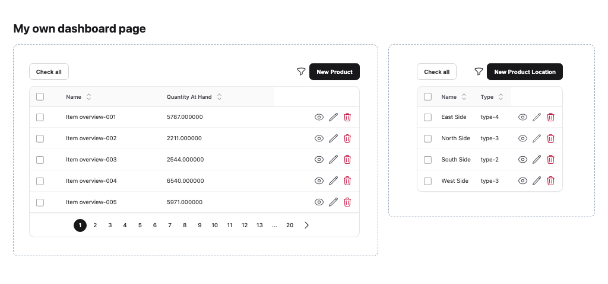

# Reusable Components

`auix_create_ui` generates three LiveComponents for each resource, and one LiveView:

| Module | Kind | Role |
|---|---|---|
| `.IndexComponent` | LiveComponent | The list: streams, filters, sort, pagination and selection |
| `.FormComponent` | LiveComponent | The create and edit form |
| `.ShowComponent` | LiveComponent | The read-only detail view |
| `.Index` | LiveView | Lists the records, owns the routes and opens the form and the show view in a modal |

This guide shows how to embed the components in a LiveView you write.

## Embedding a component

```elixir
defmodule MyAppWeb.DashboardLive do
  use MyAppWeb, :live_view

  on_mount Aurora.Uix.Live.ComponentHooks

  def render(assigns) do
    ~H"""
    <.live_component
      module={MyAppWeb.ProductViews.Product.IndexComponent}
      id="low-stock"
      where={[{:quantity_at_hand, :lt, 10}]}
    />
    """
  end

  def handle_info({Aurora.Uix, "low-stock", {:open, :show, id}}, socket) do
    {:noreply, assign(socket, :selected_id, id)}
  end

  def handle_info({Aurora.Uix, _component_id, _intent}, socket), do: {:noreply, socket}
end
```

<div align="center">
    
</div>

The page above embeds the index components of two resources side by side.

## Inputs

| Input | Applies to | Meaning |
|---|---|---|
| `id` | all | Required. DOM ids, stream names, form ids and event targets derive from it |
| `resource` | all | A resource of the LiveView that renders the component, an atom. Defaults to the resource the module was generated for; see [Naming and reusing generated modules](#naming-and-reusing-generated-modules) |
| `entity` | form, show | The record to render |
| `entity_id` | form, show | The id of the record; the component loads it. Use it instead of `entity` |
| `action` | form, show | `:new`, `:edit`, `:show` or `:show_edit` |
| `where`, `order_by` | index | The scope of the list |
| `page` | index | The page to display. Defaults to the first |
| `options` | index | A keyword list of index layout options for this instance |
| `parent` | index | `{key, value}`: the owner key and its value, for a list of children |
| `notify` | all | Who receives the outputs: a pid or `{module, id}`. Defaults to `self()` |
| actor assign | all | The assign named by `ash_actor_assign`, as in the generated LiveView |

`options` overrides the index layout options (pagination, filters, selection, sort) for one instance. An
option it leaves out takes the value the layout declares.

## Outputs

A component reports to its parent with a message `{Aurora.Uix, component_id, intent}`:

| Intent | Sent when |
|---|---|
| `{:saved, entity}` | The form saved a record |
| `{:closed}` | The form or the show view closed |
| `{:open, action, id}` | The user asked to open a record; `action` is `:show`, `:edit` or `:new` |
| `{:page, page}` | The index moved to another page |
| `{:deleted, ids}` | The index deleted records. A refused row delete sends nothing and shows the flash "Item could not be deleted" |

A component never patches, navigates or reads the URL. The form sends these in every host. The show view
and the index component send them when you embed them. In the generated `.Index` LiveView, the back and
edit actions of the show view are events of that LiveView.

## Events

Every event of an embedded component carries `phx-target`, so it never reaches the host LiveView.
`@auix._myself` holds the target in the index component, the form and the show view. It is `nil` in the
generated `.Index` LiveView. There the list events, the back and edit actions of the show view, the record
navigator and the actions of a one-to-many list carry no target and reach the LiveView.
A custom action sends its event to the component with it:

```heex
<.auix_link phx-click="archive" phx-target={@auix._myself}>Archive</.auix_link>
```

`auix_link`, `auix_link_back` and `auix_back` pass `phx-target` through; without it they behave as before.

## Navigation

A component does not know how it is used. It reports what the user asked for, and its parent decides what
that means: render a form, assign a selected record, change the URL, or nothing.

The generated `.Index` LiveView is one such parent. It answers `{:saved, entity}` and `{:closed}` from its
form with a patch or a navigate under its routes, with the routing stack in `?routing_stack=`. Its list, the
back and edit actions of its show view, the record navigator and the actions of a one-to-many list are its
own events, and it navigates on them as before. Its URLs are the ones it always had.
`Aurora.Uix.Navigation` computes each path, and the LiveView applies it.

In the generated LiveView, `@auix.navigation` holds the `%Aurora.Uix.Navigation{}`: the base path, the
current path and the routing stack. `@auix.uri_path`, `@auix.uri_path_id`, `@auix.routing_stack` and
`@auix[:index_new_link]` remain readable there. They mirror `@auix.navigation`. Change navigation with
`auix_route_forward/2` and `auix_route_back/1`, not by assigning those keys.

## Live updates

A component takes data changes through its own `update/2`:

```elixir
send_update(MyAppWeb.ProductViews.Product.IndexComponent, id: "low-stock", auix_event: event)
```

`on_mount Aurora.Uix.Live.ComponentHooks` does this for a whole LiveView: it subscribes to the topics of the
resources its components display and forwards each `%Aurora.Uix.Event{}` to every component instance.
Without the hook the components work, and update only when the host calls `send_update/2` itself. The
generated `.Index` LiveView subscribes on its own and does not use the hook.

## Several instances on one page

Components of the same resource can share a page, each with its own `id`, scope and options. Selection,
filters, sort, pagination and the open record are per instance. A data change reaches every instance, and
each one re-reads with its own scope.

## Generating the components alone

```elixir
auix_create_ui generate: [:index_component, :form_component, :show_component] do
  index_columns :product, [:reference, :name]
end
```

`generate:` lists the modules to generate. It defaults to
`[:index_live, :index_component, :form_component, :show_component]`.

## Naming and reusing generated modules

Every generated module has a name, an atom, in the module that declares it:

| Module | Default name | Named with |
|---|---|---|
| `.Index` | `:<schema>_index` | an `index_live` line |
| `.IndexComponent` | `:<schema>_index_component` | `module_name:` on `index_columns` |
| `.FormComponent` | `:<schema>_form_component` | `module_name:` on `edit_layout` |
| `.ShowComponent` | `:<schema>_show_component` | `module_name:` on `show_layout` |

`<schema>` is the last part of the schema module, in snake case. A name you give is the last part of the
module, as you wrote it: no suffix is added. `auix_modules/0` returns the modules by name, and
`auix_module/1` returns one. A generated module tells its kind with `auix_kind/0` and the fields its
layout places with `auix_fields/0`.

The examples share three schemas. `Product` has many `ProductTransaction` (`:product_transactions`, a
one-to-many) and belongs to a `ProductLocation` (`:product_location_id`, a many-to-one).

### One module

```elixir
defmodule MyAppWeb.InventoryViews do
  use Aurora.Uix

  alias MyApp.Inventory
  alias MyApp.Inventory.{Product, ProductLocation, ProductTransaction}

  auix_resource_metadata :product, context: Inventory, schema: Product
  auix_resource_metadata :product_transaction, context: Inventory, schema: ProductTransaction
  auix_resource_metadata :product_location, context: Inventory, schema: ProductLocation

  auix_create_ui do
    index_columns :product, [:reference, :name]

    edit_layout :product do
      inline [:reference, :name]
      stacked [:product_location_id, :product_transactions]
    end

    index_columns :product_transaction, [:type, :quantity, :cost]
    index_columns :product_location, [:reference, :name]
  end
end
```

Every resource with a schema generates its four modules, also without a layout line. The modules, under
`MyAppWeb.InventoryViews`:

| Name | Module |
|---|---|
| `:product_index` | `Product.Index` |
| `:product_index_component` | `Product.IndexComponent` |
| `:product_form_component` | `Product.FormComponent` |
| `:product_show_component` | `Product.ShowComponent` |
| `:product_transaction_index` | `ProductTransaction.Index` |
| `:product_transaction_index_component` | `ProductTransaction.IndexComponent` |
| `:product_transaction_form_component` | `ProductTransaction.FormComponent` |
| `:product_transaction_show_component` | `ProductTransaction.ShowComponent` |
| `:product_location_index` | `ProductLocation.Index` |
| `:product_location_index_component` | `ProductLocation.IndexComponent` |
| `:product_location_form_component` | `ProductLocation.FormComponent` |
| `:product_location_show_component` | `ProductLocation.ShowComponent` |

The transactions list in the product form is rendered by `ProductTransaction.IndexComponent`. Each
association finds its resource by the schema it relates to, so neither field needs `resource:`.

### Resources in one module, the UI in another

```elixir
defmodule MyAppWeb.InventoryMetadata do
  use Aurora.Uix

  alias MyApp.Inventory
  alias MyApp.Inventory.{Product, ProductLocation, ProductTransaction}

  auix_resource_metadata :product, context: Inventory, schema: Product
  auix_resource_metadata :product_transaction, context: Inventory, schema: ProductTransaction
  auix_resource_metadata :product_location, context: Inventory, schema: ProductLocation
end

defmodule MyAppWeb.InventoryViews do
  use Aurora.Uix

  alias MyAppWeb.InventoryMetadata

  @auix_resource_metadata InventoryMetadata.auix_resources()

  auix_create_ui do
    index_columns :product, [:reference, :name]

    edit_layout :product do
      inline [:reference, :name]
      stacked [:product_location_id, :product_transactions]
    end

    index_columns :product_transaction, [:type, :quantity, :cost]
    index_columns :product_location, [:reference, :name]
  end
end
```

`InventoryMetadata` generates no module. `InventoryViews` generates the twelve modules of the first
example, under the same names. The resources can also be imported one by one:
`@auix_resource_metadata %{product: InventoryMetadata.auix_resource(:product)}`.

### Reusing components from another views module

```elixir
defmodule MyAppWeb.ProductViews do
  use Aurora.Uix

  alias MyApp.Inventory
  alias MyApp.Inventory.{Product, ProductLocation, ProductTransaction}

  auix_resource_metadata :product, context: Inventory, schema: Product
  auix_resource_metadata :product_transaction, context: Inventory, schema: ProductTransaction
  auix_resource_metadata :product_location, context: Inventory, schema: ProductLocation

  auix_create_ui do
    index_columns :product, [:reference, :name]

    # Without module_name: the name is :product_form_component and the module Product.FormComponent.
    edit_layout :product, module_name: :product_form do
      inline [:reference, :name]
      stacked [:product_location_id, :product_transactions]
    end

    index_columns :product_transaction, [:type, :quantity, :cost]
    index_columns :product_location, [:reference, :name]
  end
end

defmodule MyAppWeb.CatalogViews do
  use Aurora.Uix

  alias MyApp.Inventory
  alias MyApp.Inventory.Product
  alias MyAppWeb.ProductViews

  auix_resource_metadata :catalog_product, context: Inventory, schema: Product

  @auix_resource_metadata %{
    product_transaction: ProductViews.auix_resource(:product_transaction),
    product_location: ProductViews.auix_resource(:product_location)
  }
  @auix_modules %{
    catalog_form: ProductViews.auix_module(:product_form),
    transactions_list: ProductViews.auix_module(:product_transaction_index_component)
  }

  auix_create_ui do
    index_columns :catalog_product, [:name]
    edit_layout :catalog_product, use: :catalog_form
    index_columns :product_transaction, use: :transactions_list
    index_columns :product_location, [:name]
  end
end
```

`ProductViews` generates the twelve modules of the first example, except that the product form is
`:product_form`, the module `Product.ProductForm`.

`:catalog_product` links its associations to the two resources `CatalogViews` imports, so the reused form
shows its location select and its transactions list. The list is rendered by `:transactions_list`.

`@auix_modules` imports a module under a name of your choice, and `use:` takes it for the resource of its
line instead of generating one. A `use:` line has no field list, no block and no other option. `CatalogViews`
imports `:catalog_form` and `:transactions_list`, and generates, under `MyAppWeb.CatalogViews`:

| Name | Module |
|---|---|
| `:product_index` | `Product.Index` |
| `:product_index_component` | `Product.IndexComponent` |
| `:product_show_component` | `Product.ShowComponent` |
| `:product_transaction_index` | `ProductTransaction.Index` |
| `:product_transaction_form_component` | `ProductTransaction.FormComponent` |
| `:product_transaction_show_component` | `ProductTransaction.ShowComponent` |
| `:product_location_index` | `ProductLocation.Index` |
| `:product_location_index_component` | `ProductLocation.IndexComponent` |
| `:product_location_form_component` | `ProductLocation.FormComponent` |
| `:product_location_show_component` | `ProductLocation.ShowComponent` |

Two rules are checked when the module compiles: the kind of the component matches the layout line, and
the resource has every field the layout of the component places. The two resources may have different
schemas. A LiveView cannot be taken this way. Two views modules that import from each other do not
compile.

### Two resources on one schema

```elixir
defmodule MyAppWeb.InventoryViews do
  use Aurora.Uix

  alias MyApp.Inventory
  alias MyApp.Inventory.{Product, ProductLocation, ProductTransaction}

  auix_resource_metadata :product do
    context Inventory
    schema Product
    field :product_transactions, resource: :product_transaction_compact
  end

  auix_resource_metadata :product_transaction, context: Inventory, schema: ProductTransaction

  auix_resource_metadata :product_transaction_compact do
    context Inventory
    schema ProductTransaction
    field :cost, readonly: true
  end

  auix_resource_metadata :product_location, context: Inventory, schema: ProductLocation

  auix_create_ui do
    index_columns :product, [:reference, :name]

    edit_layout :product do
      inline [:reference, :name]
      stacked [:product_location_id, :product_transactions]
    end

    index_columns :product_transaction, [:type, :quantity, :cost, :inserted_at]

    edit_layout :product_transaction do
      inline [:type, :quantity, :cost]
      stacked [:product_id]
    end

    show_layout :product_transaction do
      inline [:type, :quantity, :cost]
    end

    index_columns :product_transaction_compact, [:type, :quantity], module_name: :transactions_compact
    edit_layout :product_transaction_compact, use: :product_transaction_form_component
    show_layout :product_transaction_compact, use: :product_transaction_show_component
    index_live :product_transaction_compact, module_name: :compact_transactions

    index_columns :product_location, [:reference, :name]
  end
end
```

The module generates the twelve modules of the first example, and two more:

| Name | Module |
|---|---|
| `:transactions_compact` | `ProductTransaction.TransactionsCompact` |
| `:compact_transactions` | `ProductTransaction.CompactTransactions`, the LiveView |

Two generated modules with one name do not compile. `:product_transaction` and
`:product_transaction_compact` describe the same schema, so the second one names its index component and
its LiveView, and takes the form and the show view of the first with `use:`, by their default names. The
transactions list in the product form is `ProductTransaction.TransactionsCompact`: the `resource:` option
of the field says which of the two resources the list shows. An association needs `resource:` only then.

`auix_resource_metadata` takes its options on the line, or a block that holds them with the field
options. It does not take both.

### In a LiveView you write

A LiveView you write attaches the components it needs with `auix_create_ui`, and generates nothing with
`generate: []`. `use:` takes the module that `auix_module/1` of the other views module returns, so the
LiveView needs no `@auix_modules`. With `MyAppWeb.ProductViews` from the example above:

```elixir
defmodule MyAppWeb.ProductReviewLive do
  use MyAppWeb, :live_view
  use Aurora.Uix

  alias MyApp.Inventory
  alias MyApp.Inventory.{Product, ProductLocation, ProductTransaction}
  alias MyAppWeb.ProductViews

  auix_resource_metadata :product_review do
    context Inventory
    schema Product
    field :reference, readonly: true
  end

  auix_resource_metadata :product_transaction, context: Inventory, schema: ProductTransaction
  auix_resource_metadata :product_location, context: Inventory, schema: ProductLocation

  auix_create_ui generate: [] do
    edit_layout :product_review, use: ProductViews.auix_module(:product_form)
    index_columns :product_transaction, use: ProductViews.auix_module(:product_transaction_index_component)
  end

  def mount(%{"id" => id}, _session, socket), do: {:ok, assign(socket, :id, id)}

  def render(assigns) do
    ~H"""
    <.live_component
      module={ProductViews.auix_module(:product_form)}
      id="product-review-form"
      resource={:product_review}
      entity_id={@id}
    />
    """
  end
end
```

The LiveView generates no module. `resource` is a name: the component looks it up in the LiveView that
renders it, and serves it with the layout its `use:` line attached. It raises `ArgumentError` in three
cases: that LiveView has no `auix_create_ui`; it has no such resource; it attaches another module to the
resource. Without `resource` a component serves the resource it was generated for.
A component keeps its resource: give another resource a component with its own `id`.

`:product_review` describes `Product` with its own field options. The second `use:` line attaches the
index component that lists the transactions inside the form.

### Routes

Route to a renamed LiveView with `index_live:`:

```elixir
auix_live_resources("/compact-transactions", MyAppWeb.InventoryViews.ProductTransaction,
  index_live: :compact_transactions
)
```

## One-to-many lists

A one-to-many field renders an `IndexComponent` scoped to the parent record. In the generated LiveView it
looks and acts as before: its new, show and edit actions navigate to the child resource's routes. The list
has no filters, selection, sort and paging.

The list takes its columns from the index layout of the resource the field shows. When two resources
describe the schema of the children, `resource:` on the field says which one; see
[Two resources on one schema](#two-resources-on-one-schema).

## Design decisions

1. **Compatibility.** The generated `.Index` LiveView keeps the full `IndexImpl` contract: its callbacks, the
   delivery of `send(self(), msg)` to `auix_handle_info/2`, and the `@auix` keys. A separate
   `IndexComponentImpl` behaviour covers the component.
2. **Presentation.** The form and the show view render without modal chrome. The generated `.Index` LiveView
   wraps them in a modal.
3. **Components report, parents decide.** A component never navigates. It tells its parent what the user
   asked for, and the parent decides. The generated `.Index` LiveView is one such parent: it turns the
   intents of its form into patches and navigations.
4. **One-to-many keeps its behaviour.** The child list is an embedded `IndexComponent` with the same
   columns, actions and `name` attributes. Editing children in place is opt-in and comes later.
5. **Live updates go through `update/2`.** The `on_mount` hook is wiring, not contract.
6. **The LiveView owns the URL.** No component reads or writes it, so any number of instances share a page.
