# Layout System

Aurora UIX provides a flexible layout DSL for organizing fields in index, form, and show views.

The layout system gives you full control over UI structure. By default, Aurora UIX generates layouts automatically from your resource metadata, so you get a functional interface with no extra code. When you need custom arrangements, use the provided DSL to create anything from simple field groupings to complex, tabbed forms with nested sections—all with concise, readable code.

## Core Concepts

### Layout Types

Each layout type determines how your resource's fields are presented:

- **`index_columns`** — Selects which fields appear in the list (table) view and their order. Takes a list of field names, and a `do` block with a `card` that lays out the card view (see [Index Cards](#index-cards)).
- **`edit_layout`** — Controls how fields are arranged when creating or editing a resource. Renders input fields with metadata options like `placeholder` and `required`.
- **`show_layout`** — Specifies read-only detail view layout using the same resource metadata but rendered as static values.

### Sub-Layout Containers

Sub-layouts are organizational containers that structure how fields are displayed. You can nest them freely to achieve complex layouts:

- **`inline(fields)`** — Arranges fields/sub-layouts horizontally in a single row
- **`stacked(fields)`** — Arranges fields/sub-layouts vertically in a column (default when no layout defined)
- **`group(title, fields)`** or **`group(title, do_block)`** — Visually groups related fields under a title with a border/frame
- **`sections(do_block)`** — Creates a tabbed container; use with `section` blocks
- **`section(title, fields)`** or **`section(title, do_block)`** — Represents a single tab; holds fields or nested layouts
- **`field(key, options)`** — Places one field, with options, inside a block

Every option is checked when the module compiles: an unknown layout or field option, a layout for
a resource the module does not declare, a field the resource does not have, a `section` outside
`sections`, or two layouts of the same type for one resource fails compilation at that line. The
full reference is `Aurora.Uix.Layout.CreateUI`.

### Field Options

Field-level customizations (like `readonly`, `hidden`, `renderer`) defined in your resource metadata are automatically applied wherever the field appears, across all layouts.

## Layout Examples

All examples below use this resource metadata:

```elixir
auix_resource_metadata :product do
  context MyApp.Inventory
  schema Product
  field :reference, required: true
  field :name, required: true
  field :description
  field :list_price, precision: 12, scale: 2
  field :quantity_initial
  field :quantity_entries
  field :quantity_exits
  field :quantity_at_hand
end
```

### 1. Default Layout (No Configuration)

When you don't define a layout, Aurora UIX automatically generates one from all available fields:

```elixir
auix_create_ui do
  # No layout specified - Aurora generates defaults for index, show, and edit
end
```

Generated layouts:
- **Index**: Shows all fields in table columns

<!-- Screenshot captured in test server URL: create-ui-default-layout-products -->
<!-- ../../test/cases_live/create_ui_default_layout_test.exs -->
<div align="center">
    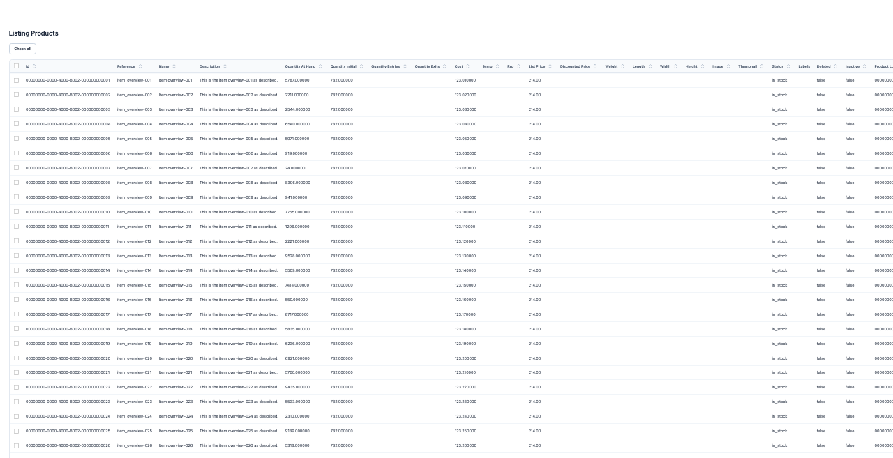
</div>

- **Show / Edit**: Displays fields in vertical (stacked) order. `default_fields_layout: :inline`
  on `auix_create_ui` places them side by side instead. It applies only to the show and edit
  layouts that are generated, not to the ones you declare:

```elixir
auix_create_ui default_fields_layout: :inline do
  index_columns :product, [:reference, :name]
end
```

<div align="center">
    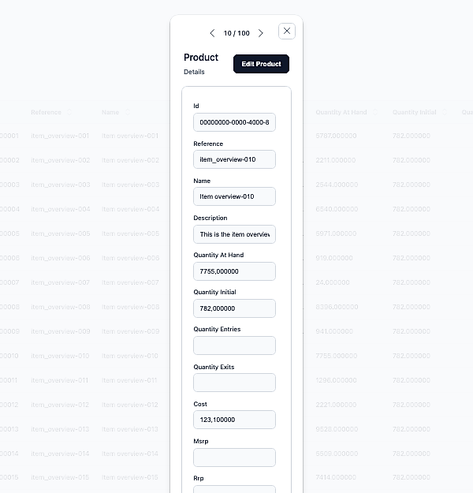
</div>

---

<div align="center">
    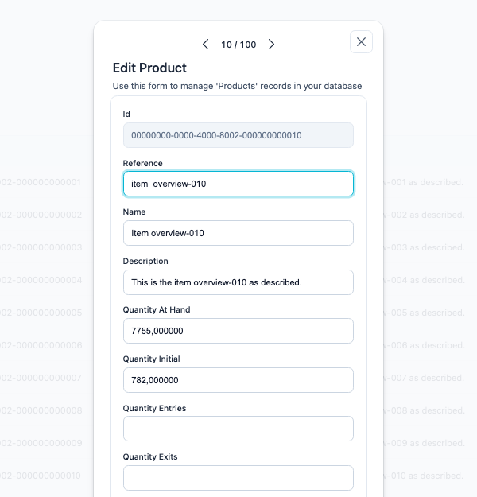
</div>

### 2. Inline Layout — Horizontal Field Arrangement
<!-- Screenshot captured in test server URL: association-many_to_one_selector-layout-product_locations -->
<!-- In edit mode -->
<!-- ../../test/cases_live/association_many2one_selector_ui_layout_test.exs -->
Use `inline` to display fields side-by-side in a row:

```elixir
edit_layout :product_location do
  inline [:reference, :name, :type]
end
```

**Result**: Three fields displayed horizontally in a single row.

<div align="center">
    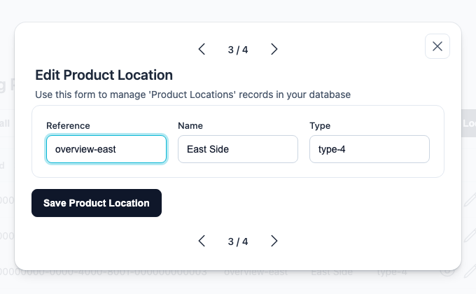
</div>

### 3. Stacked Layout — Vertical Field Arrangement
<!-- Screenshot captured in test server URL: association-many_to_one_selector-layout-products -->
<!-- In edit mode -->
<!-- ../../test/cases_live/association_many2one_selector_ui_layout_test.exs -->

Use `stacked` to display fields one below another:

```elixir
edit_layout :product do
  stacked([
    :reference,
    :name,
    :description,
    :quantity_initial,
    :product_location_id,
    :product_location
  ])
end
```

**Result**: Fields are displayed vertically in a column.

<div align="center">
    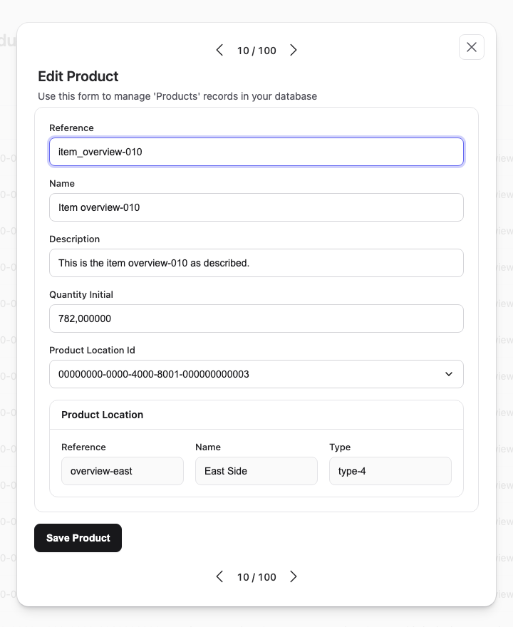
</div>

### 4. Group Layout — Bordered Field Grouping
<!-- Screenshot captured in test server URL: group-ui-layout-products -->
<!-- In edit mode -->
<!-- ../../test/cases_live/group_ui_layout_test.exs -->

Use `group(title)` to visually frame related fields under a title:

```elixir
edit_layout :product do
  group "Product Info" do
    stacked [:reference, :name, :description]
  end
end
```

Alternatively, pass fields directly without a `do` block:

```elixir
edit_layout :product do
  group "Product Info", [:reference, :name, :description]
end
```
For example:

```elixir
edit_layout :product, [] do
  inline([:reference, :name, :description])

  group "Quantities" do
    inline([:quantity_at_hand, :quantity_initial])
  end

  group "Sale Prices" do
    stacked([:list_price, :rrp])
  end
end

```
**Result**: Fields grouped in a bordered section with a title.

<div align="center">
    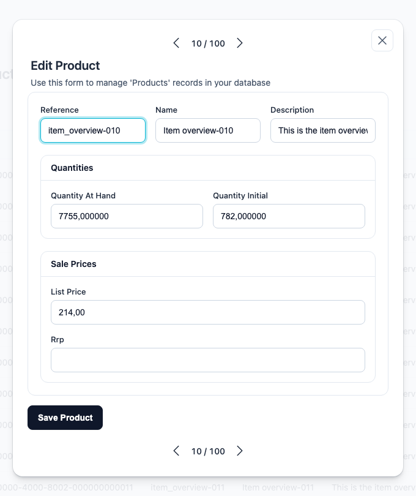
</div>

### 5. Sections Layout — Tabbed Interface
<!-- Screenshot captured in test server URL: section-ui-layout-products -->
<!-- In edit mode -->
<!-- ../../test/cases_live/section_ui_layout_test.exs -->

Use `sections` with `section` blocks to create a tabbed interface:

```elixir
  auix_create_ui do
    edit_layout :product, [] do
      inline([:reference, :name, :description])

      # section_index_1
      sections do
        # section_index_1, tab_index_1
        section "Quantities" do
          inline([:quantity_at_hand, :quantity_initial])
        end

        # section_index_1, tab_index_2
        section "Sale Prices" do
          stacked([:list_price, :rrp])
        end
      end
    end
  end
```

**Result**: Multiple tabs; clicking a tab shows only that section's fields.

<div align="center">
    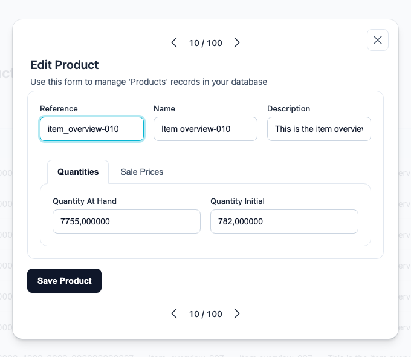
</div>

---

<div align="center">
    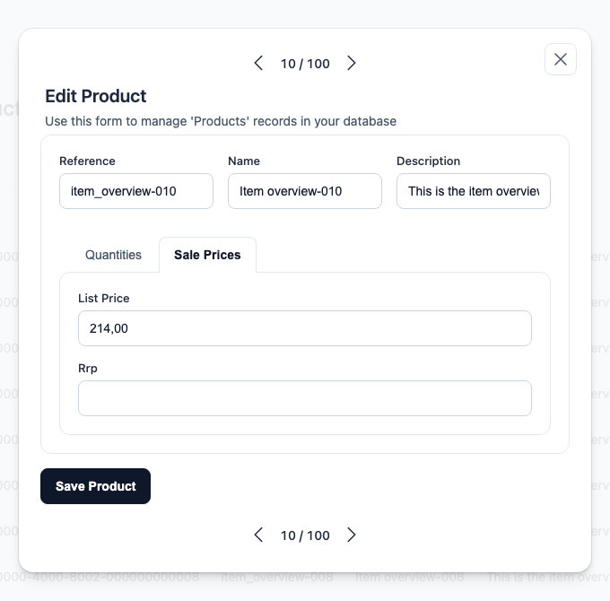
</div>

### 6. Complex Nested Layout
<!-- Screenshot captured in test server URL: nested-sections-ui-layout-products -->
<!-- In edit mode -->
<!-- ../../test/cases_live/nested_sections_ui_layout_test.exs -->

Combine all layout types for sophisticated UIs:

```elixir
  auix_create_ui do
    edit_layout :product, [] do
      # sections_index_1
      sections do
        # sections_index_1 tab_index_1
        section "References" do
          inline([:reference, :name])

          # sections_index_2
          sections do
            # sections_index_2 tab_index_1
            section "Descriptions" do
              inline([:description, :status])
            end

            # sections_index_2 tab_index_2
            section "Specifications" do
              stacked do
                inline([:width, :height, :length])
                inline([:weight])
              end
            end
          end
        end

        # sections_index_1 tab_index_2
        section "Information" do
          # sections_index_3
          sections do
            # sections_index_3 tab_index_1
            section "Quantities" do
              inline([:quantity_at_hand, :quantity_initial])
            end

            # sections_index_3 tab_index_2
            section "Sale Prices", default: true do
              stacked([:list_price, :rrp])
            end
          end
        end
      end
    end
  end

```

**Result**:
- "References" tab: reference and name in one row, followed by the nested tabs "Descriptions"
  (description and status) and "Specifications" (dimensions and weight)
- "Information" tab: the nested tabs "Quantities" and "Sale Prices", the latter open by default

<div align="center">
    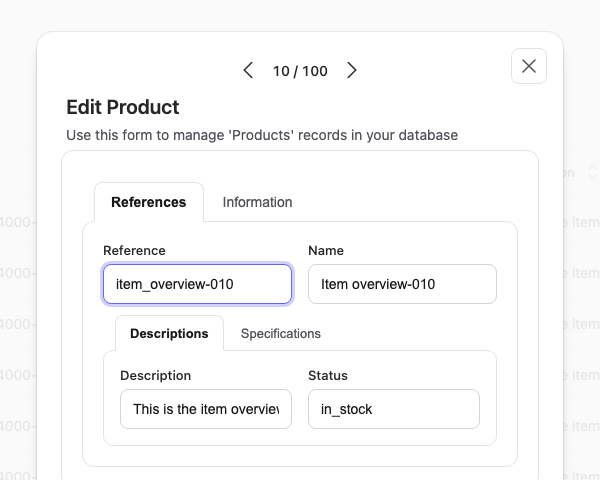
</div>

---

<div align="center">
    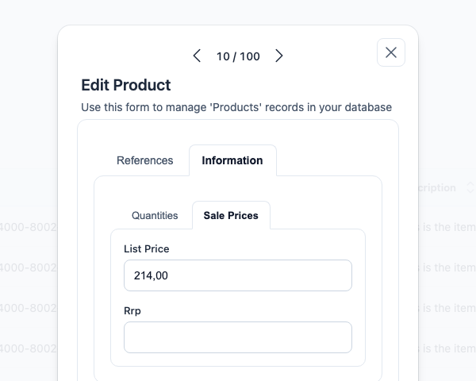
</div>

---

<div align="center">
    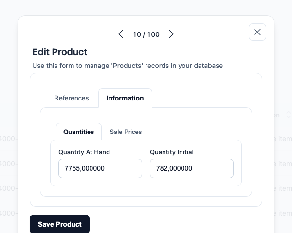
</div>
## Layout Customization

### Layout Options by Type

Each layout type (`:index`, `:form`, `:show`) supports specific customization options that control titles, subtitles, pagination, and more.

<a id="index-layout-options"></a>

#### Index Layout Options

Controls list view pagination, titles, and row/header actions:

```elixir
index_columns :product, [:reference, :name, :list_price],
  page_title: "Products",
  page_subtitle: "Manage your inventory",
  pagination_items_per_page: 20,
  pagination_disabled?: false,
  order_by: [asc: :name],
  where: [{:inactive, false}]
```

**Options:**
- `:page_title` — Main title (default: `"Listing {title}"`)
- `:page_subtitle` — Subtitle (default: empty)
- `:pagination_items_per_page` — Rows per page (default: 40)
- `:pagination_disabled?` — Disable pagination (default: `false`)
- `:sort_disabled?` — Turn off user sorting: no sortable column headers, no sort control in the card view, and the `"index-sort"` event is ignored. `:order_by` still applies. Accepts a boolean or an arity-1 function of the assigns (default: `false`)
- `:new_action_label` — Label for the "new" action button (default: `"New {name}"`)
- `:action_icons` — The icons of the default actions, by action name, such as `[default_new: "hero-sparkles"]`. Below the 640px breakpoint a default action button shows only its icon (see [Custom Actions › Action Icons](../customization/custom_actions.md#action-icons))
- `:preload` — Associations the list loads besides the ones the layout renders, such as `[:category, posts: :author]`. It replaces the resource's `preload` for this layout (see [Index Query Options](resource_metadata.md#index-query-options))
- `:order_by` — Initial sort order; uses `Aurora.Ctx.QueryBuilder` syntax on both backends. Clicking a sortable column header replaces it until the page is reloaded
- `:where` — Query filter; uses `Aurora.Ctx.QueryBuilder` syntax. Conditions submitted from the filter bar are added to it; they never replace it. An OR condition goes inside `:where` as a `dynamic/2` expression on Ecto resources; on Ash resources, filter in a custom read action (see [Custom Actions](ash_integration.md#custom-actions)). `:or_where` and `:select` are not index options
- `:infinite_scroll_items_load`, `:pages_bar_range_offset` — see [Pagination and Infinite Scroll](#pagination-and-infinite-scroll)
- `:get_streams`, `:row_id` — see [Stream Functions](#stream-functions)

<a id="pagination-and-infinite-scroll"></a>

#### Pagination and Infinite Scroll

<div align="center">
    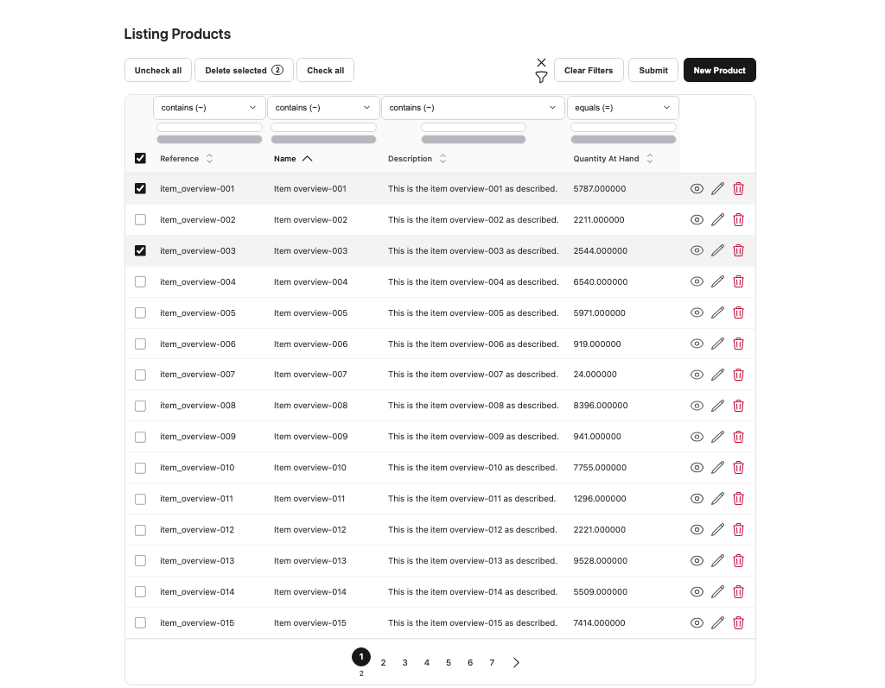
</div>

From the 768px breakpoint up, a list of more than one page has a page bar under its rows. A number
below a page link counts the rows selected on that page. Below the breakpoint there is no page bar.

The list scrolls without pages in two cases:

- **`pagination_disabled?: true`**: the list reads `infinite_scroll_items_load` rows (default: 200)
  and adds the next batch when you reach its end.
- **The card list** (see [Index Cards](#index-cards)): reaching its end switches the list to
  infinite scroll. It reads again from the first row, in batches of `infinite_scroll_items_load`,
  and the page bar is gone for the rest of that visit.

```elixir
index_columns :product, [:reference, :name],
  pagination_disabled?: true,
  infinite_scroll_items_load: 100
```

`:pages_bar_range_offset` sets how many page links the bar shows on each side of the current page.
It takes a named function of arity 2, called with `nil` and the breakpoint: `:md`, `:lg`, `:xl` or
`:xl2`. The defaults are 4, 6, 8 and 10.

```elixir
defmodule MyAppWeb.ProductPages do
  def offset(_assigns, :xl2), do: 5
  def offset(_assigns, :xl), do: 4
  def offset(_assigns, _breakpoint), do: 2
end

defmodule MyAppWeb.ProductViews do
  use Aurora.Uix

  auix_resource_metadata :product, context: MyApp.Inventory, schema: MyApp.Inventory.Product

  auix_create_ui do
    index_columns :product, [:reference, :name],
      pages_bar_range_offset: &MyAppWeb.ProductPages.offset/2
  end
end
```

<a id="stream-functions"></a>

#### Stream Functions

Two index options replace functions the list uses to render its
[streams](liveview.md#working-with-streams). Each takes a named function of arity 1:

- `:get_streams` — Receives the assigns of the render and returns the streams the list reads
  (default: the `streams` assign).
- `:row_id` — Receives a row as `{dom_id, item}` and returns the DOM id of the table row or card
  (default: `dom_id`). LiveView finds a streamed element by its stream id, so keep the default
  unless something else needs another id.

<a id="index-cards"></a>

#### Index Cards

Below the 768px breakpoint the index shows one card per record instead of a table row. Without
any configuration the card is derived from the columns: the first column is the title, and the
others follow as `label · value` rows.

A `card` inside the `do` block of `index_columns` lays the card out:

```elixir
index_columns :product, [:reference, :name, :msrp, :status, :quantity_at_hand] do
  card title: :name, subtitle: :reference, show_on: :all do
    inline [:msrp, :status]
    group "Stock", [:quantity_at_hand]
  end
end
```

With `show_on: :all` the cards also fill a wide screen, as a grid:

<div align="center">
    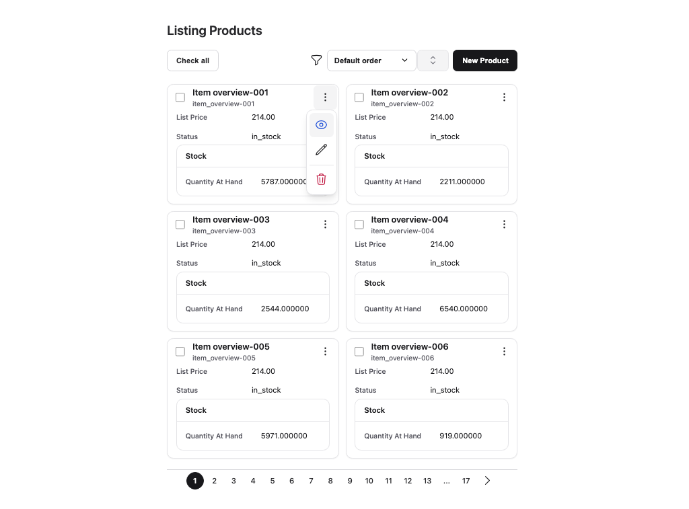
</div>

**Card options:**
- `:title` — The card title: a field, a text, or a named function of arity 1. The function receives the assigns, with the record in `assigns.entity`
- `:subtitle` — A second line under the title; takes the same values as `:title`
- `:show_on` — `:mobile` (default) shows the cards below the 768px breakpoint and the table from it up. `:all` shows the cards at every breakpoint, as a responsive grid, and renders no table

The card body takes `inline`, `stacked`, `group` and `field`. `sections` is not allowed in a
card. Options given to a field inside the card apply to the card only:

```elixir
index_columns :product, [:reference, :name, :quantity_at_hand] do
  card title: :name do
    field :quantity_at_hand, label: "On hand"
  end
end
```

The selection checkbox and the row actions belong to the card frame. The header holds the
checkbox, the title and subtitle, and a ⋮ menu of row actions; tapping the card opens the
record's show view (see
[Custom Actions › Row actions in cards](../customization/custom_actions.md#row-actions-in-cards)).

The field list is the single source of fields for the table columns, the data loading, the sort
and the filters:

| Declared | Columns, sort and filters | Card |
|---|---|---|
| field list | the list | derived |
| field list and `card` | the list | as declared; it may reorder and omit columns, and may not add one (compile-time error) |
| `card` | the card fields: title, subtitle, then the body in order | as declared |
| neither | the default columns | derived |

A column the card omits stays sortable and filterable. With `show_on: :all` the table headers are
gone, so the card sort control and the filter cards show at every breakpoint.

The card sort control is a field select and a direction switch. Below the 640px breakpoint it is
one icon button instead: its menu lists "Default order" and the sortable fields, then "Ascending"
and "Descending", and checks the active field and direction. The button is highlighted while a
field sort is on.

A call with a `card` and no field list takes its options after an empty list:
`index_columns :product, [], page_title: "Products" do ... end`.

#### Form Layout Options

Controls edit/new form titles and subtitles:

```elixir
edit_layout :product,
  edit_title: "Edit Product",
  edit_subtitle: "Update product details",
  new_title: "Create New Product",
  new_subtitle: "Add a product to your inventory"
do
  stacked [:reference, :name, :description]
end
```

**Options:**
- `:edit_title` — Title for edit form (default: `"Edit {name}"`)
- `:edit_subtitle` — Subtitle for edit form (default: `"Use this form to manage '{title}' records in your database"`)
- `:new_title` — Title for create form (default: `"New {name}"`)
- `:new_subtitle` — Subtitle for create form (default: `"Creates a new '{name}' record in your database"`)
- `:save_action_label` — Label for the save action button (default: `"Save {name}"`)
- `:action_icons` — The icon of the save action, such as `[default_save: "hero-check"]` (see [Custom Actions › Action Icons](../customization/custom_actions.md#action-icons))
- `:unsaved_changes_guard_disabled?` — When `true`, closing the form modal with unsaved changes closes it without asking for confirmation (default: `false`, the guard is on)
- `:record_navigator` — Where the [record navigator](#record-navigator) shows on the edit form (default: `[:top, :bottom]`)

#### Show Layout Options

Controls detail view titles and subtitles:

```elixir
show_layout :product,
  page_title: "Product Details",
  page_subtitle: "Full product information"
do
  stacked [:reference, :name, :description, :list_price]
end
```

**Options:**
- `:page_title` — Main title (default: `"{name}"` - the resource name)
- `:page_subtitle` — Subtitle (default: `"Details"`)
- `:edit_action_label` — Label for the edit action button (default: `"Edit {name}"`)
- `:back_action_label` — Label for the back action (default: `"Back to {title}"`)
- `:action_icons` — The icons of the edit and back actions, such as `[default_back: "←"]` (see [Custom Actions › Action Icons](../customization/custom_actions.md#action-icons))
- `:record_navigator` — Where the [record navigator](#record-navigator) shows (default: `[:top, :bottom]`)

<a id="record-navigator"></a>

#### Record Navigator

The show view and the edit form have a bar with previous and next arrows around the position of the
record, such as `1 / 100`, in the filtered and sorted list. The arrows continue onto the previous
or next page. The [Overview](../overview/overview.md#desktop-views) shows it on a show view.

Each of the two layouts sets its own `:record_navigator`:

```elixir
show_layout :product, record_navigator: :top do
  stacked [:reference, :name]
end

edit_layout :product, record_navigator: [] do
  stacked [:reference, :name]
end
```

The value is `:top`, `:bottom`, `[:top, :bottom]`, `[]` to hide the bar, or a named function of
arity 1 that receives the assigns and returns one of those.

There is no navigator on the new form, for a record outside the loaded page (as with a direct link
to a record of another page), or on show and form [components](components.md) embedded in a page of
your own.

The navigator does not ask before it discards the unsaved changes of a form
([#727](https://github.com/wadvanced/aurora_uix/issues/727)).

<a id="your-own-layout-options"></a>

#### Your Own Layout Options

An option set adds options to a layout type. Declare each one with `option name, type`, where the
type is a `Spark.Options` type, and write a `get_default/2` clause for every option you declare:

```elixir
defmodule MyAppWeb.ProductListOptions do
  use Aurora.Uix.Layout.Options, layout_type: :index

  option :export_label, :string

  defp get_default(_assigns, :export_label), do: {:ok, "Export"}
end
```

Register the module:

```elixir
# config/config.exs
config :aurora_uix, layout_options_parsers: [MyAppWeb.ProductListOptions]
```

The library reads this key when it compiles, so recompile it after a change with
`mix deps.compile aurora_uix --force`.

Every layout of that type, on any resource, then accepts the option and checks its type at compile
time:

```elixir
index_columns :product, [:reference, :name], export_label: "Download"
```

The views of that layout type hold the value, or the default, in `@auix.layout_options`, so a
[custom action](../customization/custom_actions.md) or renderer of yours reads
`@auix.layout_options.export_label`.

When the type allows a text or a function, such as `{:or, [:string, {:fun, 1}]}`, a function of
arity 0 or 1 is called, and one of arity 1 receives the assigns. When the declared type is only a
function, such as `{:fun, 1}`, the function itself is the value.

### Dynamic Titles and Subtitles

For dynamic content, pass a captured function (`&Module.function/1`, not an anonymous `fn`). It
receives the assigns and returns rendered HTML (sigil `~H`):

```elixir
defmodule MyAppWeb.ProductTitles do
  use Phoenix.Component

  def edit_title(assigns) do
    ~H"Edit {@auix.name} {@auix.entity.reference}"
  end

  def show_title(assigns) do
    ~H"Product: {@auix.entity.name}"
  end
end

defmodule MyAppWeb.ProductViews do
  use Aurora.Uix

  auix_resource_metadata :product, context: MyApp.Inventory, schema: MyApp.Inventory.Product

  auix_create_ui do
    edit_layout :product, edit_title: &MyAppWeb.ProductTitles.edit_title/1 do
      stacked [:reference, :name, :description]
    end

    show_layout :product, page_title: &MyAppWeb.ProductTitles.show_title/1 do
      stacked [:reference, :name]
    end
  end
end
```

The record of the form and show views is `@auix.entity`. An index title has no record.

> **Note:** This is separate from the resource's own `name`/`title` metadata (set via
> `auix_resource_metadata`), which many of the defaults above interpolate (e.g. `"New
> {name}"`, `"Back to {title}"`). Those accept a plain `binary()` or a captured **0-arity**
> function returning a `binary()` — a different signature from the arity-1, `assigns`-receiving
> functions documented here. See [Resource Metadata → Display Name and
> Title](resource_metadata.md#display-name-and-title).

### Field-Level Options

Customize individual fields within any layout using keyword options, either in a field list
or with `field` inside a block:

```elixir
edit_layout :product do
  inline do
    field :reference, readonly: true, length: 20
    field :name, placeholder: "Product name", length: 100
    field :id, hidden: true
  end
end
```

A field list made only of `key: options` pairs, such as
`inline [reference: [readonly: true], name: []]`, or only of association paths such as
`{:category_id, :name}`, is read as the sub-layout's own options and fails compilation. Write
those fields with `field`, as above. A list that also holds a plain field works:
`inline [{:reference, [readonly: true]}, :name]`.

**Relevant Field Options:**
- `:readonly` — Make field read-only
- `:hidden` — Hide field from UI
- `:renderer` — Custom rendering function (form/edit and show layouts)
- `:index_renderer` — Custom rendering function for the index layout only
- `:edit_renderer` — Custom rendering function for the form (edit) layout only
- `:show_renderer` — Custom rendering function for the show layout only
- `:renderer_opts` — Settings the renderer reads, such as `[max: 10]` for `:rating` (see [Predefined Renderers](../customization/predefined_renderers.md))
- `:length` — Input field character width
- `:placeholder` — Placeholder text
- `:sortable?` — Set to `false` to remove the sort control from this column's index header. An upload field (one with an `upload` block) never offers one, even with `sortable?: true`
- `:option_label` — For select/radio fields
- `:action_icons` — For one-to-many and embeds-many fields: the icons of the field's default actions (see [Custom Actions › Action Icons](../customization/custom_actions.md#action-icons))
- `:order_by`, `:where` — For one-to-many fields: the order and filter of the listed rows (see [Resource Metadata › One-to-Many](resource_metadata.md#one-to-many-has_many))

Per-layout renderers are especially useful for index columns, which the generic `:renderer`
does not cover:

```elixir
index_columns :product, [
  :reference,
  name: [index_renderer: &MyAppWeb.Helpers.product_name_link/1]
]
```

> **Note:** A layout accepts every resource field option, `:expanded` (for `embeds_many` fields)
> included: `contacts: [expanded: true]` in an `edit_layout` or `show_layout` opens the collection in
> that view, over the value of `auix_resource_metadata` — see the
> [Resource Metadata](resource_metadata.md#selector-embed-and-upload-options) guide.

For complete field attributes reference, see the `Aurora.Uix.Field` module documentation.

## Actions: Customizing Buttons and Links

Aurora UIX provides an action system for the buttons and links rendered in headers, footers, rows
and selection bars. A layout changes them with options such as `add_row_action`,
`replace_header_action` and `remove_row_action`:

```elixir
index_columns :product, [:reference, :name], remove_row_action: :default_row_show
```

The [Custom Actions](../customization/custom_actions.md) guide holds the full reference: action
groups per layout type, the `add_`/`insert_`/`replace_`/`remove_` operations, the default action
names, the action function signature and the assigns available inside an action.

## Advanced Patterns

### Nesting Fields and Blocks

Layouts can accept either a list of fields or a `do` block containing nested layouts:

```elixir
# Direct field list
inline [:reference, :name]

# Nested block with sub-layouts
inline do
  group "Section 1", [:reference, :name]
  group "Section 2", [:description]
end

# Mixed: both fields and nested blocks are allowed
stacked do
  inline [:reference, :name]
  group "Details" do
    stacked [:description, :list_price]
  end
end
```

### QueryBuilder for Advanced Filtering

Aurora UIX index layouts support advanced filtering and sorting. The `:where` and `:order_by` options are passed to `Aurora.Ctx.QueryBuilder.options/2` on Ecto resources and translated by `Aurora.Uix.Integration.Ash.QueryParser` on Ash resources; both accept the syntax below.

**Basic Filtering with Tuples:**

```elixir
index_columns :product, [:reference, :name, :list_price],
  where: [{:inactive, false}],
  order_by: [asc: :name, desc: :inserted_at]
```

**Using Comparison Operators:**

The `:where` option accepts tuples with operators for complex filtering:

```elixir
index_columns :product, [:reference, :name, :list_price],
  where: [
    {:list_price, :greater_than, 10},
    {:name, :ilike, "%widget%"}
  ],
  order_by: :name
```

**Supported Comparison Operators:**

- `:greater_than` or `:gt` - Greater than
- `:greater_equal_than` or `:ge` - Greater than or equal
- `:less_than` or `:lt` - Less than
- `:less_equal_than` or `:le` - Less than or equal
- `:equal_to` or `:eq` - Equal to
- `:like` - Pattern matching (SQL LIKE with `%` and `_`)
- `:ilike` - Case-insensitive pattern matching
- `:between` - Range query (requires start and end values)
- `:in` - Membership in a list of values (`{:status, :in, [:active, :pending]}`); the value is always a list

**Range Filtering with Between:**

```elixir
index_columns :product, [:reference, :name, :list_price],
  where: [{:reference, :between, "A", "M"}],
  order_by: :reference
```

**Multiple Sort Fields:**

```elixir
index_columns :product, [:reference, :name, :list_price],
  order_by: [asc: :status, desc: :list_price, asc: :name]
```

This enables:
- Complex filtering with comparison operators
- Multi-field sorting with customizable directions
- Pattern matching with LIKE/ILIKE operators
- Range queries with BETWEEN operator

`dynamic/2` expressions apply to Ecto resources only; the Ash query parser accepts the tuple forms above. On Ecto resources a condition `Aurora.Ctx.QueryBuilder` does not support raises `ArgumentError` instead of being ignored. A comma-separated string is not a list: `{:status, :in, "active,pending"}` raises on Ecto and yields an invalid query on Ash. The filter bar's "in list" condition splits the typed text on commas and passes a list.

### Conditional Field Visibility

Use field options to hide fields conditionally:

```elixir
edit_layout :product do
  stacked do
    field :id, hidden: true          # Always hidden
    field :reference, readonly: true # Visible but read-only
    field :name                      # Normal editable field
  end
end
```

### Reusable Layouts

Declare layouts in their own module with `auix_create_layout`, and bring them into any module
that generates a UI with `auix_create_ui include:`:

```elixir
defmodule MyAppWeb.ProductLayouts do
  use Aurora.Uix

  auix_create_layout do
    edit_layout :product do
      inline [:reference, :name]
    end
  end
end

defmodule MyAppWeb.ProductViews do
  use Aurora.Uix

  auix_resource_metadata :product, context: MyApp.Inventory, schema: MyApp.Product

  auix_create_ui include: MyAppWeb.ProductLayouts do
    show_layout :product do
      inline [:name]
    end
  end
end
```

`include` takes one module or a list. Each module returns its layouts from `auix_layouts/0`, so a
module with `auix_create_ui` can be included too. For one resource and layout type, the module's
own layout replaces an included one, and a later included module replaces an earlier one.
Included layouts are checked against the including module's resources, and the including module
recompiles when an included module changes.

## Best Practices

1. **Keep layouts readable** — Avoid deeply nested structures; prefer multiple groups over excessive nesting
2. **Use meaningful group titles** — Titles help users understand field organization
3. **Group related fields** — Use `group` or `sections` to organize logically related fields
4. **Test responsiveness** — Layouts adjust for mobile/tablet; test on multiple screen sizes
5. **Leverage sections for long forms** — Use tabs to avoid overwhelming users with too many fields at once
6. **Keep field order consistent** — Match order between index, edit, and show layouts when possible
7. **Use field options judiciously** — Overriding too many field options makes maintenance harder; prefer metadata-level configuration

## Related guides

- [Customizing & Extending Aurora UIX](../customization/customization.md) — the central customization hub
- [Resource Metadata](./resource_metadata.md) — field configuration options
- [Custom Actions](../customization/custom_actions.md) — the full action system reference
- [LiveView Integration](./liveview.md) — handle custom events in your layouts
- [Styling Aurora UIX in a Host Application](../customization/styling.md) — styling generated layouts
- [Troubleshooting](../advanced/troubleshooting.md) — common layout issues
