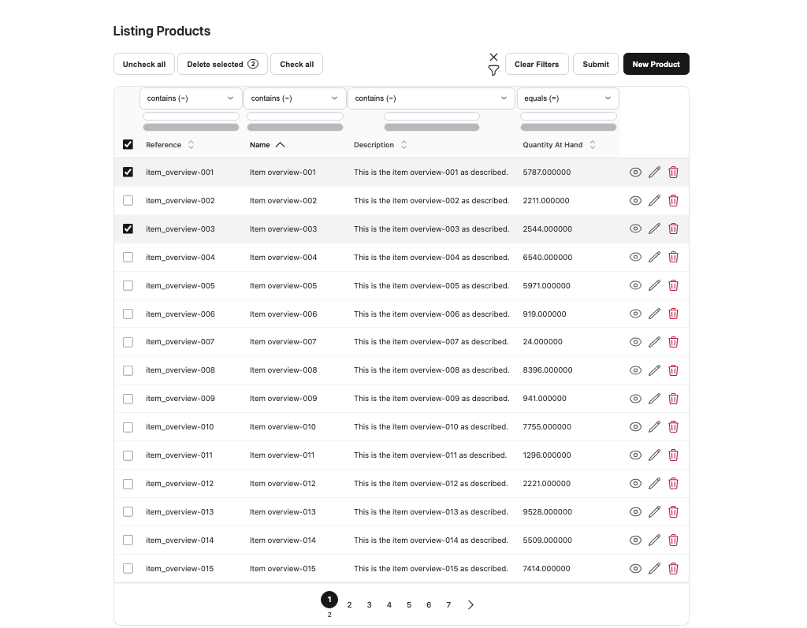

# LiveView Integration

Aurora UIX leverages Phoenix LiveView to provide dynamic, real-time CRUD interfaces. The framework generates fully-functional LiveView and LiveComponent modules at compile time, handling all the boilerplate while remaining customizable.

> #### JavaScript setup required {: .warning}
> Aurora UIX requires its client-side hooks to be imported in your `app.js`. Without this, features
> like file downloads and the theme switcher will not work. See
> [JavaScript Setup](../introduction/getting_started.md#javascript-setup) in the Getting Started
> guide.

## How It Works

### Module Generation with `auix_create_ui`

The `auix_create_ui/0` macro generates a complete set of modules for your resource. For a resource named `product`, it creates:

```
Overview.Product                      # Parent module (generated)
├── Overview.Product.Index            # LiveView - Lists the records, owns the routes
├── Overview.Product.IndexComponent   # LiveComponent - Handles the list
├── Overview.Product.FormComponent    # LiveComponent - Handles create/edit forms
└── Overview.Product.ShowComponent    # LiveComponent - Handles detail view display
```

#### Generated Module Structure

**Index Module** (`Overview.Product.Index`) - LiveView:
- Lists entities with streaming for performance
- Manages filtering, sorting, and pagination
- Handles delete operations with confirmation
- Hosts modal containers for form and show components
- Provides navigation between list and detail views
- Implements LiveView callbacks: `mount/3`, `handle_params/3`, `handle_event/3`, `handle_info/2`, `handle_async/3`

**IndexComponent Module** (`Overview.Product.IndexComponent`) - LiveComponent:
- Holds the state of an embedded list: streams, filters, sort, pagination and selection
- Can be embedded in any LiveView; see [Reusable Components](components.md)

**FormComponent Module** (`Overview.Product.FormComponent`) - LiveComponent:
- Renders create and edit forms in modals
- Handles form validation and submission
- Manages form state and changesets
- Handles section/tab switching in forms
- Implements LiveComponent callbacks: `update/2`, `handle_event/3`

**ShowComponent Module** (`Overview.Product.ShowComponent`) - LiveComponent:
- Displays entity details in modals or dedicated pages
- Renders read-only entity information
- Manages section/tab switching in show views
- Provides edit navigation
- Implements LiveComponent callbacks: `update/2`, `handle_event/3`

The routes of the `.Index` LiveView are described in
[Getting Started](../introduction/getting_started.md#3-add-routes-to-router).

## Working with Streams

The index lists its records in LiveView streams and manages them for you.

### Stream Naming

- **Primary stream** - Named by `auix.source_key` (e.g., `:products` for a product index)
- **Alternate streams** - For other views of the same records, named with the string
  `"#{source_key}__#{suffix}"`, where each suffix comes from the `:alternate_streams_suffixes`
  layout option (default: `["mobile"]`, giving `"products__mobile"`). Suffixes are arbitrary,
  host-defined strings, not built-in view types — configure additional ones
  (e.g. `"card"`, `"calendar"`) to fit your own alternate layouts.

For how the list pages and scrolls, see
[Pagination and Infinite Scroll](layouts.md#pagination-and-infinite-scroll).

### Changing What the List Shows

A stream item is not the record itself: it is the record as a plain map, with keys the library adds
for selection and row striping. Do not insert records into these streams yourself. Write the data,
then let the index read its page again:

```elixir
defmodule MyApp.ProductIndexHandler do
  use Aurora.Uix.Templates.Basic.Handlers.IndexImpl

  alias Aurora.Uix.Events

  @impl IndexImpl
  def auix_handle_event("restock", %{"id" => id}, socket) do
    {:ok, _product} = MyApp.Inventory.restock_product(id)
    Events.refresh()

    {:noreply, socket}
  end

  def auix_handle_event(event, params, socket), do: super(event, params, socket)
end
```

`Events.refresh/0` re-reads the page of this view. To update every open index, publish the change
instead (see [Publishing from host code](#publishing-from-host-code)).

## Filtering and Sorting

Aurora UIX supports sorting via configuration in both resource metadata and layout DSL. Sorting is applied automatically and can be customized per view.

<div align="center">
    
</div>

### Configuring Default Sort Order

Set `order_by:` on the resource, on the `index_columns` layout, or both; the layout's value wins:

```elixir
auix_resource_metadata :product do
  context MyApp.Inventory
  schema MyApp.Inventory.Product
  order_by :reference
  field :name, required: true
end

auix_create_ui do
  index_columns :product, [:reference, :name], order_by: :name
end
```

The order is applied by the database query, and is replaced when the user sorts: a click on a
sortable column header (a second click reverses the direction, a third restores the backend order),
or, in the mobile card view, the sort control. A column opts out with the field option
`sortable?: false`; the layout option `sort_disabled?: true` turns user sorting off for the whole
index.

The accepted values of `order_by` and `where` are listed in
[Index Query Options](resource_metadata.md#index-query-options).

### Scoping the Index Query at Runtime

The index handler keeps the query of the list in `auix.load_items_options`, a keyword list. A custom
`IndexImpl` handler can read it and replace it with `assign_auix(socket, :load_items_options, ...)`.
Only these keys are read; any other is ignored:

| Key | Value |
|-----|-------|
| `:where` | A list of conditions, a map of equalities, a single condition or a dynamic expression |
| `:order_by` | The order of the entries |
| `:preload` | Associations to load besides the ones the layout renders |

The handler builds it from the resource's options, the index layout's options and the associations the
layout renders, each time it loads the list: on mount, on `auix_route_back` and when the items per page change.
Submitting the filters and changing the sort read it again, add the submitted filters and the sort to it, and reload
the list. Other reloads, such as a refresh after a save, reuse the query last built.

Choose where to set a `where` by how long it must last:

- **From the first load on**: in `mount/3`, before calling `super`, change the layout tree. It is read at every rebuild,
  so it lasts for the life of the view.

  ```elixir
  def mount(params, session, %{assigns: %{auix: auix}} = socket) do
    layout_tree = struct(auix.layout_tree, where: {:reference, :lt, "item_test-06"})

    super(params, session, assign_auix(socket, :layout_tree, layout_tree))
  end
  ```

- **After the list is loaded**: replace `load_items_options`. It applies from the next filter submit or sort change,
  and the next rebuild discards it. To last, also change the layout tree as above.

  ```elixir
  load_items_options =
    Keyword.put(auix.load_items_options, :where, [{:reference, :lt, "item_test-06"}])

  assign_auix(socket, :load_items_options, load_items_options)
  ```

The other query assigns of `auix` (`query_options`, `read_items`) are internal: they change between releases.

## Navigation

`Aurora.Uix.Navigation` describes the navigation of the generated LiveView as plain data. The state is
`@auix.navigation`, an `%Aurora.Uix.Navigation{}` with the base path, the current path and the routing stack.
The functions take that struct and return data.

| Function | Returns |
|---|---|
| `Navigation.path(nav, action, id)` | The path of `:index`, `:new`, `:show`, `:edit` or `:show_edit` |
| `Navigation.forward(nav, target)` | `{nav, route}`: `nav` has the current path pushed on the routing stack, and `route` leads to `target` (`patch: path` or `to: path`) |
| `Navigation.back(nav)` | `{nav, route}`: `nav` has the routing stack popped, and `route` leads back |

A route is `%{type: :patch | :navigate, path: path}`. Its path carries the routing stack in `routing_stack=`.

`auix_route_forward/2` calls `Navigation.forward/2` and `auix_route_back/1` calls `Navigation.back/1` on
`@auix.navigation`; each stores the returned struct and pushes the returned route. Use them in a handler:

```elixir
def auix_handle_event("archive", _params, socket) do
  {:noreply, auix_route_back(socket)}
end
```

The generated LiveView navigates with a patch for a change within the view, a navigate for another view,
and the routing stack in `?routing_stack=` so that back returns to where the user came from. The components
never navigate: they report to the LiveView that hosts them; see [Reusable Components](components.md).

`@auix.uri_path`, `@auix.uri_path_id`, `@auix.routing_stack` and `@auix[:index_new_link]` mirror the
navigation state and stay readable from custom actions.

## Performance Considerations

### Streams for Large Lists

Aurora UIX uses Phoenix LiveView streams for index views, which efficiently handle:
- Inserts/updates/deletes without full re-render
- Pagination for large datasets
- Lazy loading capabilities

### Preloading Associations

Association fields that a layout renders are preloaded with the entity, so there is no
per-field preload option to set. To load an association the layout does not render, list it in the
resource's or the index layout's `preload` (see
[Index Query Options](resource_metadata.md#index-query-options)).

An association field that names its resource with `resource:` also loads, for each related
record, the association fields that the layouts of the named resource render, one level deep.
Without `resource:` it loads the related records alone.

### Async Operations

Run heavy work with `start_async/3` and receive the result in `auix_handle_async/3`:

```elixir
defmodule MyApp.ProductIndexHandler do
  use Aurora.Uix.Templates.Basic.Handlers.IndexImpl

  @impl IndexImpl
  def auix_handle_event("export", _params, socket) do
    {:noreply, start_async(socket, :export, fn -> MyApp.Inventory.export_products() end)}
  end

  def auix_handle_event(event, params, socket), do: super(event, params, socket)

  @impl IndexImpl
  def auix_handle_async(:export, {:ok, _result}, socket) do
    {:noreply, put_flash(socket, :info, "Export finished")}
  end

  def auix_handle_async(task, result, socket), do: super(task, result, socket)
end
```

Keep the `super` clauses: the index runs its own events and async tasks through the same callbacks.

## Debugging

### Inspecting Socket Assigns

The `:auix` assign holds the configuration and the runtime state. To look at it, inspect it from a
handler:

```elixir
defmodule MyApp.ProductIndexHandler do
  use Aurora.Uix.Templates.Basic.Handlers.IndexImpl

  @impl IndexImpl
  def auix_mount(params, session, socket) do
    {:ok, socket} = super(params, session, socket)
    IO.inspect(Map.keys(socket.assigns.auix), label: "auix")

    {:ok, socket}
  end
end
```

### LiveView DevTools

The generated views are ordinary LiveViews, so
[Phoenix LiveDashboard](https://hexdocs.pm/phoenix_live_dashboard) shows their processes like any
other. Applications created with `mix phx.new` serve it at `/dev/dashboard`.

## Best Practices

1. **Keep handlers focused** - One concern per handler module
2. **Use streams** - Always use streams for list views instead of assigning the full list
3. **Validate early** - Validate inputs in `handle_event` before database operations
4. **Handle errors gracefully** - Provide user feedback for all operations
5. **Preload data** - Configure preloads to avoid N+1 queries
6. **Test in isolation** - Test handlers independently from LiveView
7. **Document custom events** - Document any custom event handlers for team clarity

## Related guides

- [Reusable Components](components.md) — embedding the index, form and show components in your own LiveView
- [Customizing & Extending Aurora UIX](../customization/customization.md) — the central customization hub; behavior hooks are [section 5](../customization/customization.md#5-customizing-liveview-behavior)
- [Custom Actions](../customization/custom_actions.md) — the buttons and links that fire the events you handle here
- [Layout System](layouts.md) — where handler modules are attached via layout options
- [Getting Started](../introduction/getting_started.md) — the required JavaScript hooks setup

