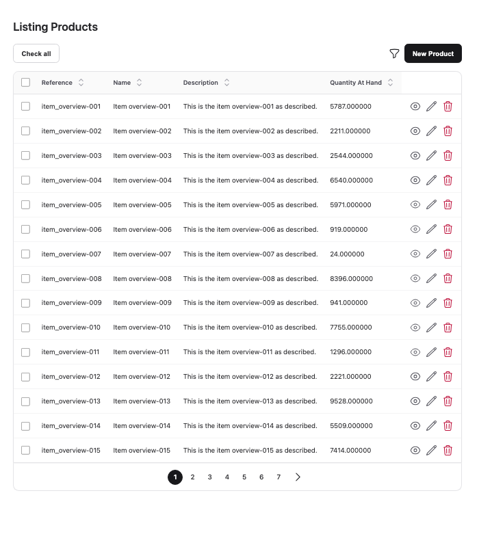
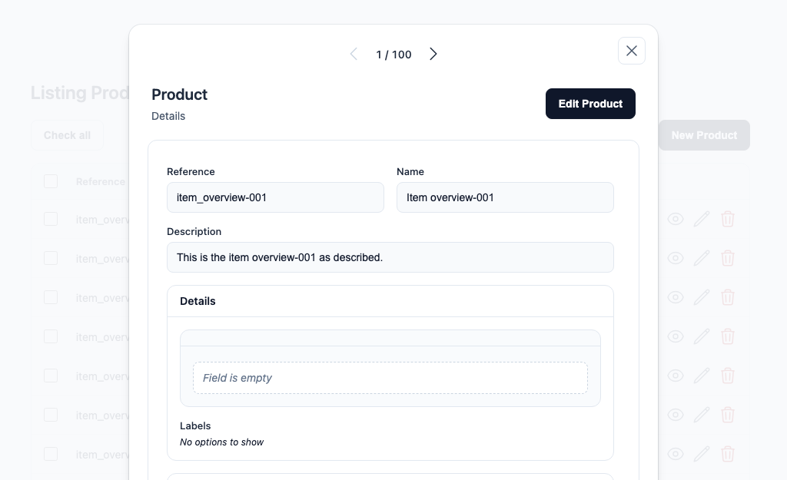
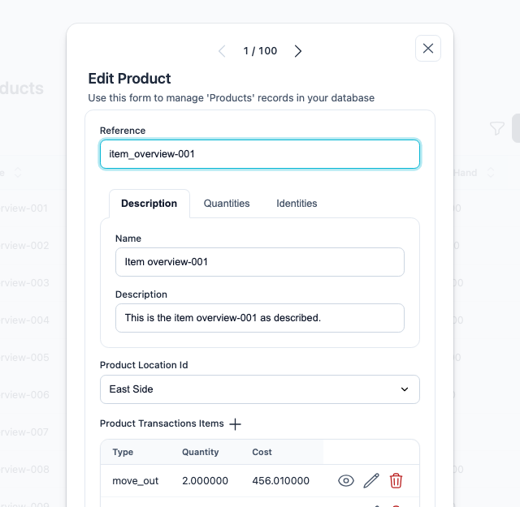
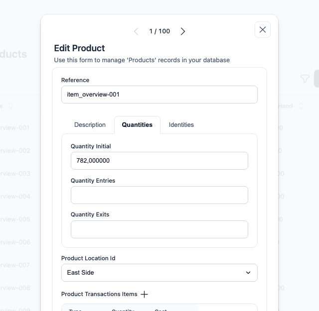
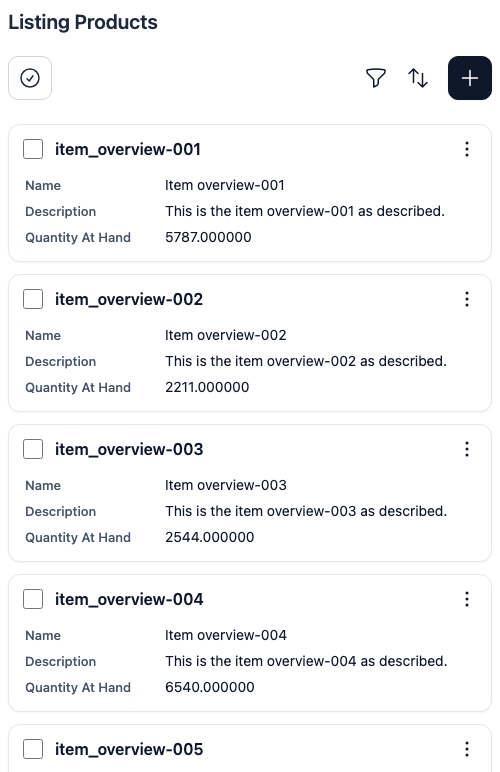
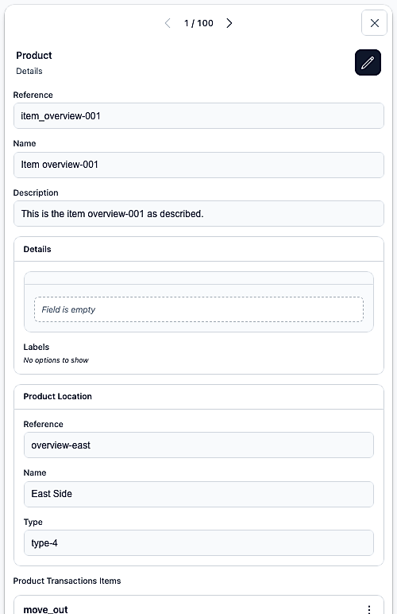
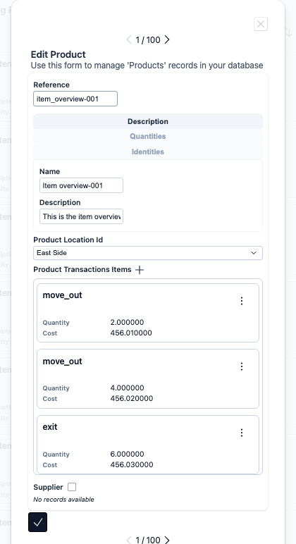
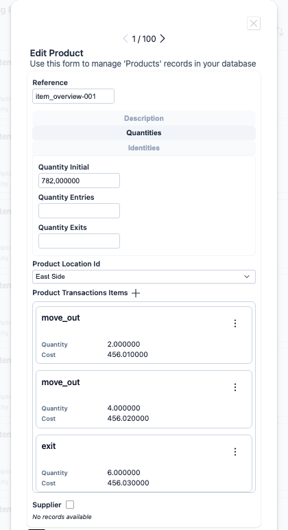

# Aurora UIX Overview

Welcome to **Aurora UIX** — a low-code, metadata-driven UI framework for Elixir's Phoenix ecosystem.

Aurora UIX helps you rapidly generate complete CRUD user interfaces with minimal boilerplate code. By leveraging declarative resource metadata and a powerful layout DSL, you can build feature-rich, maintainable UIs with compile-time code generation and automatic LiveView integration.

## Core Architecture

Aurora UIX is built on three interconnected components:

### 1. Resource Metadata
Define UI configuration declaratively using the `auix_resource_metadata` macro. Specify field-level options, validation rules, labels, and association handling all in one place.

```elixir
auix_resource_metadata :product do
  context Inventory
  schema Product
  field :name, placeholder: "Product name", required: true
  field :price, precision: 12, scale: 2
end
```

### 2. Layout DSL
Compose complex, nested layouts for index, show, and edit views using a flexible declarative syntax. Combine layout elements like `inline`, `stacked`, and `sections` to organize your UI.

```elixir
show_layout :product do
  stacked do
    inline [:name, :price]
    sections do
      section "Details" do
        stacked [:description, :category]
      end
    end
  end
end
```

### 3. Compile-Time Code Generation
Aurora UIX generates optimized LiveView modules and HEEx templates at compile time, not runtime. This ensures fast performance, type safety, and maintainable code.

## Key Features

### Generate

- **Complete CRUD views** - Index, show and form views from your resource metadata and layouts
- **Two backends** - Ecto schemas with [`aurora_ctx`](https://hexdocs.pm/aurora_ctx) contexts, or Ash resources, detected automatically
- **Associations and embeds** - `belongs_to`, `has_many`, `has_one`, `many_to_many`, `embeds_one` and `embeds_many`
- **File uploads** - An [`upload` block](../core/resource_metadata.md#file-uploads) turns a field into a LiveView upload
- **Compile-time checks** - An unknown or mistyped DSL option fails compilation at the line that declares it

### Work with data

- **Filtering and sorting** - Filters on the index fields (turn one off with `filterable?: false`), sortable column headers, and `where` and `order_by` to scope a list
- **Pagination** - Pages in the table, infinite scroll in the card view
- **Live updates** - With a PubSub server configured, [open lists re-read their page](../core/liveview.md#reacting-to-data-changes) when another session saves or deletes a record
- **Ash authorization** - The current actor is [passed to every generated call](../core/ash_integration.md#authorization-and-policies), so your policies apply
- **Ash calculations and aggregates** - [Discovered and loaded](../core/ash_integration.md#calculations-and-aggregates) like any other field

### Embed

- **[Reusable components](../core/components.md)** - Place the generated index, form and show views inside LiveViews you write

### Adapt

- **Layouts** - Compose `inline`, `stacked`, `group` and `sections`, and [reuse layouts](../core/layouts.md#reusable-layouts) across modules with `include:`
- **Responsive cards** - Small screens show [one card per record](../core/layouts.md#index-cards); a layout can design the card and show it at every width
- **Themes** - White Charcoal, Vitreous Marble and Blue Graphite, in light and dark, or [your own](../customization/theming.md)
- **Actions** - [Add, replace or remove buttons](../customization/custom_actions.md), change their icons, and run [bulk actions](../customization/custom_actions.md#bulk-actions-on-selected-rows) on selected rows
- **Renderers and components** - Built-in field renderers such as toggle switch, badge, progress bar and rating, your own renderers, templates and [component overrides](../customization/customization.md)
- **Behavior** - [Handler hooks](../core/liveview.md#handler-hooks) for your business logic
- **Internationalization** - A [configurable Gettext backend](../core/internationalization.md)

## Complete Example

Here's a example showing Resource Metadata and Layout DSL working together to create a complete inventory management interface:

```elixir
defmodule MyAppWeb.InventoryViews do
  use Aurora.Uix

  alias MyApp.Inventory
  alias MyApp.Inventory.{Product, ProductLocation, ProductTransaction}

  # Define UI metadata for each resource
  auix_resource_metadata(:product_location, context: Inventory, schema: ProductLocation)

  auix_resource_metadata(:product_transaction, context: Inventory, schema: ProductTransaction)

  auix_resource_metadata :product do
    context Inventory
    schema Product
    field :name, placeholder: "Product name", required: true
    field :price, precision: 12, scale: 2
  end

  # Define layouts for each view
  auix_create_ui do
    # Index view configuration
    index_columns :product, [:reference, :name, :price, :quantity_at_hand],
      pagination_items_per_page: 15

    # Show view configuration
    show_layout :product do
      stacked do
        inline [:reference, :name]
        inline [:description]
        inline [:price, :quantity_at_hand]
        inline [:product_location, :product_transactions]
      end
    end

    # Edit view configuration with organized sections
    edit_layout :product do
      stacked do
        inline [:reference]
        sections do
          section "Basic Information" do
            stacked [:name, :description]
          end
          section "Pricing" do
            stacked [:price, :cost]
          end
          section "Inventory" do
            stacked [:quantity_initial, :quantity_entries]
          end
        end
        inline [:product_location_id]
      end
    end
  end
end
```

**Result**: A complete product management interface with:
- ✅ Responsive list view with pagination
- ✅ Detailed product view with organized sections
- ✅ Editable form with grouped fields
- ✅ Association handling (location selection, transaction links)
- ✅ Automatic validation and error handling
- ✅ Real-time updates via LiveView

## Reusable Components

`auix_create_ui` generates an `IndexComponent`, a `FormComponent` and a `ShowComponent` for each
resource, next to the `Index` LiveView. Use them to add Aurora UIX to one screen of an existing
application, or to combine several lists and forms on a page of your own:

```elixir
defmodule MyAppWeb.DashboardLive do
  use MyAppWeb, :live_view

  on_mount Aurora.Uix.Live.ComponentHooks

  def render(assigns) do
    ~H"""
    <.live_component
      module={MyAppWeb.InventoryViews.Product.IndexComponent}
      id="low-stock"
      where={[{:quantity_at_hand, :lt, 10}]}
    />
    """
  end

  # A component never navigates: it tells its parent what the user asked for.
  def handle_info({Aurora.Uix, _component_id, _intent}, socket), do: {:noreply, socket}
end
```

The [Reusable Components](../core/components.md) guide describes the inputs, the messages and how
to handle them.

## Generated UI Examples

Aurora UIX generates complete, responsive CRUD interfaces. Here are examples of automatically generated interfaces:

### Desktop Views

<!-- Screenshot captured in test server, or phx.server URL: guides-overview/products -->
#### List View (Paginated Index)
<div align="center">
    
</div>

#### Detail View (Show)
<div align="center">
    
</div>

#### Edit View with Sections
<div align="center">
    
</div>

#### Section Navigation
<div align="center">
    
</div>

### Mobile Views

Aurora UIX layouts are fully responsive and adapt to mobile devices:

#### Mobile List View (Infinite Scroll)
<div align="center">
    
</div>
#### Mobile Detail View (Show)
<div align="center">
    
</div>

#### Mobile Edit View with Sections
<div align="center">
    
</div>

#### Mobile Section Navigation
<div align="center">
    
</div>


## Who Should Use Aurora UIX?

Aurora UIX is ideal for:

- **Rapid Prototyping** - Build CRUD interfaces in minutes, not days
- **Internal Tools & Admin Panels** - Generate admin interfaces for business logic
- **MVP Development** - Focus on business logic, not UI boilerplate
- **Data Management Apps** - Applications centered around data entry and management
- **Convention-Driven Teams** - Teams that value consistency and predictable patterns

Aurora UIX works best when:
- Your primary need is CRUD operations with standard UI patterns
- You want to minimize repetitive form and list code
- Consistency across the application is important
- You want compile-time safety and performance

## Documentation & Next Steps

### Getting Started

Ready to build your first Aurora UIX interface? Follow these steps:

1. **[Getting Started Guide](../introduction/getting_started.md)** - 10-minute setup and first CRUD interface
2. **[Resource Metadata Guide](../core/resource_metadata.md)** - Learn how to configure resources
3. **[Layout System Guide](../core/layouts.md)** - Get to know the layout DSL
4. **[Reusable Components Guide](../core/components.md)** - Embed the generated views in your own LiveViews

### Customization & Extension

To make the generated UI look and behave like your application, start at the central hub —
it catalogs every customization mechanism (styling, theming, component overrides, custom
actions, renderers, behavior hooks) with deep links:

- **[Customizing & Extending Aurora UIX](../customization/customization.md)** — start here
- **[Advanced Usage Guide](../advanced/advanced_usage.md)** — custom templates and backends
- **[LiveView Integration](../core/liveview.md)** — behavior hooks and event handling

### Troubleshooting

Guide for tackling known issues and corner cases:

- **[Troubleshooting](../advanced/troubleshooting.md)**
