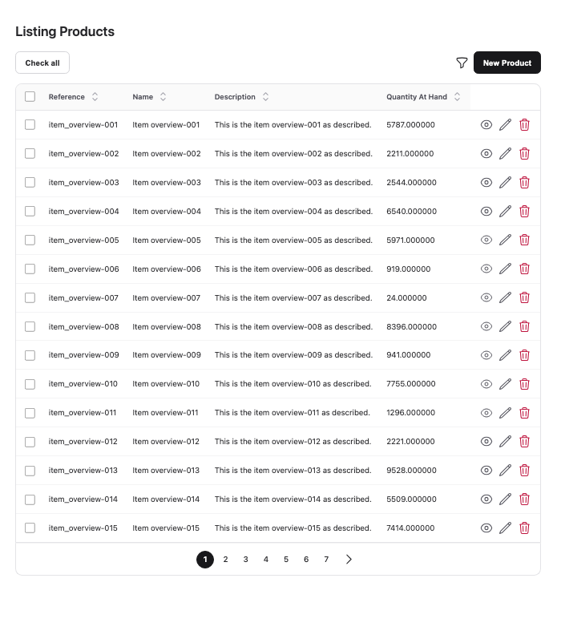
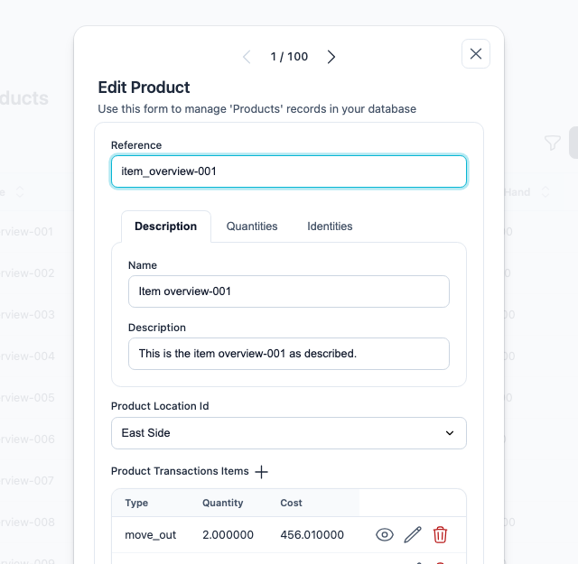
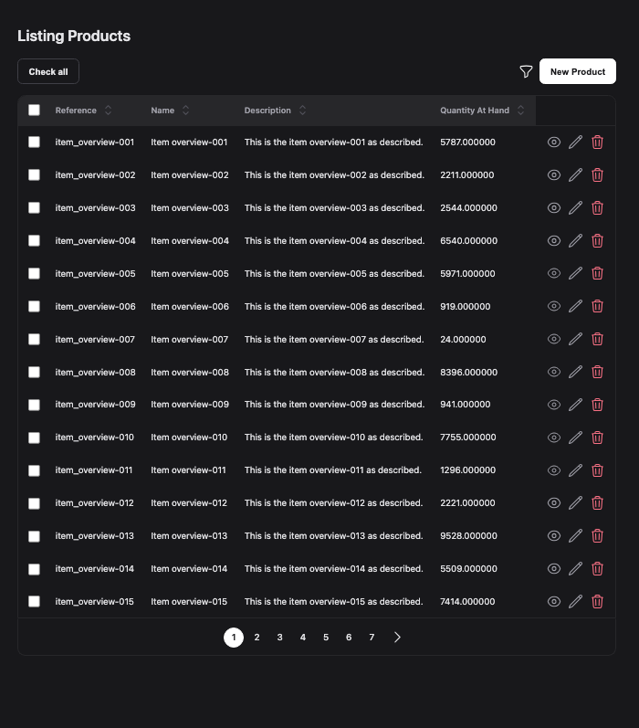
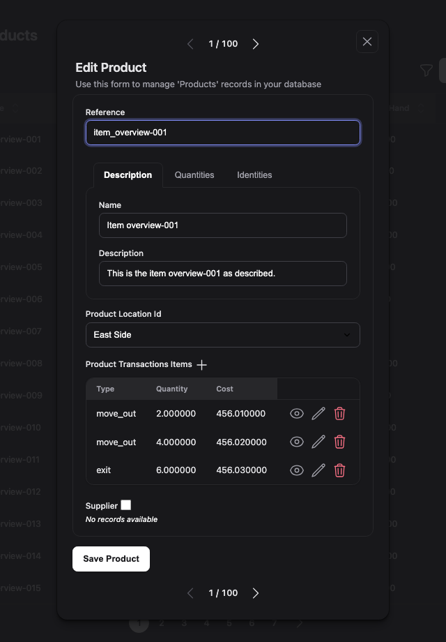
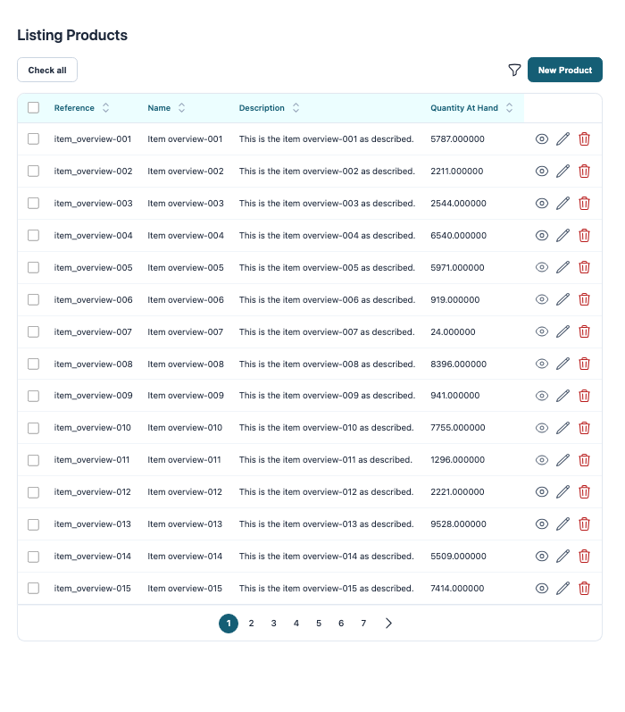
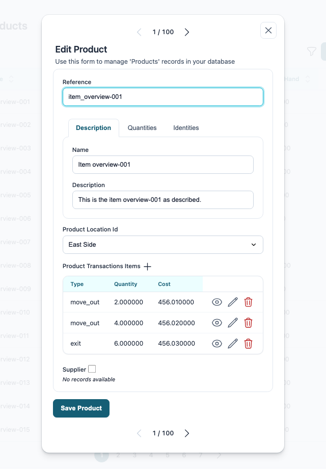
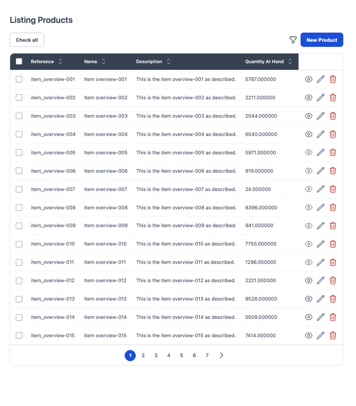
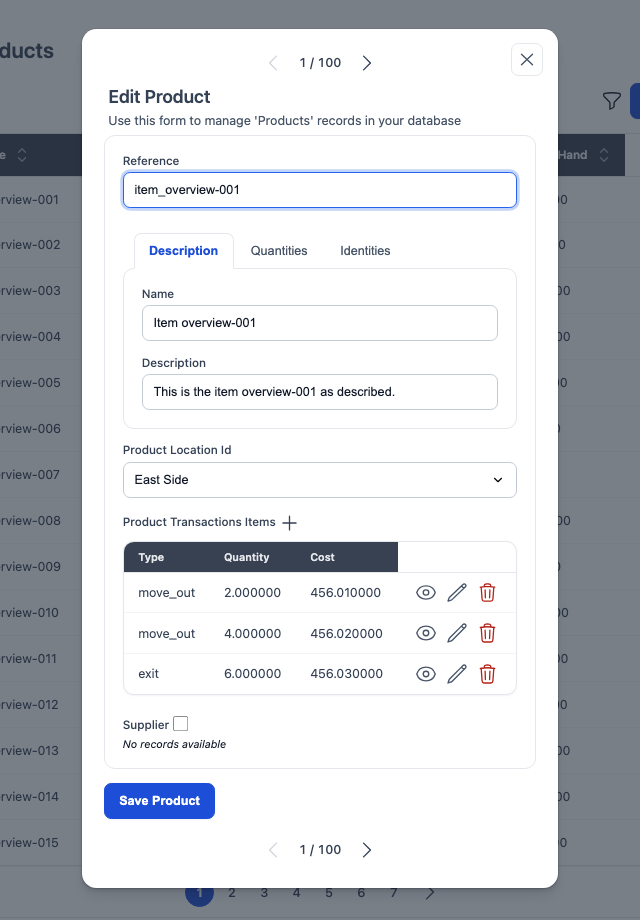

# Theme Gallery

Aurora UIX ships with three themes. Each one is shown below with the same product list and edit
form, so you can compare them.

| Theme | Name in the configuration | Look |
|---|---|---|
| [White Charcoal](#white-charcoal) | `:white_charcoal` (default) | Neutral grays with charcoal buttons |
| [Vitreous Marble](#vitreous-marble) | `:vitreous_marble` | Slate text, a teal primary and pale cyan table headers |
| [Blue Graphite](#blue-graphite) | `:blue_graphite` | Slate text, a blue primary and graphite table headers |

## Choosing a Theme

```elixir
# config/config.exs
config :aurora_uix, theme_name: :blue_graphite
```

Then generate the stylesheet again with `mix auix.gen.stylesheet`, and set the same name in the
`data-theme-name` attribute of your root layout (see
[Using Custom Themes](../customization/theming.md#using-custom-themes)).

Every theme has a light and a dark variant. The page follows the browser's color scheme, and
`data-theme="light"` or `data-theme="dark"` on the `<html>` element forces one (see
[Light and Dark Modes](../customization/theming.md#understanding-light-and-dark-modes)). To make a
theme of your own, see [Creating Custom Registered Themes](../customization/theming.md).

## White Charcoal

The default theme.

<div align="center">
    
</div>

<div align="center">
    
</div>

### Dark

<div align="center">
    
</div>

<div align="center">
    
</div>

## Vitreous Marble

<div align="center">
    
</div>

<div align="center">
    
</div>

## Blue Graphite

<div align="center">
    
</div>

<div align="center">
    
</div>
